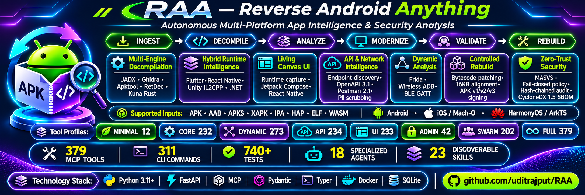
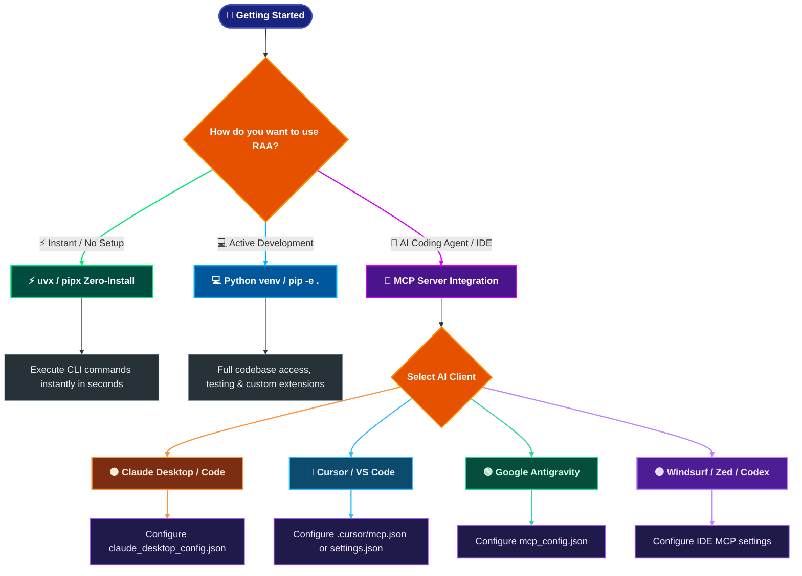
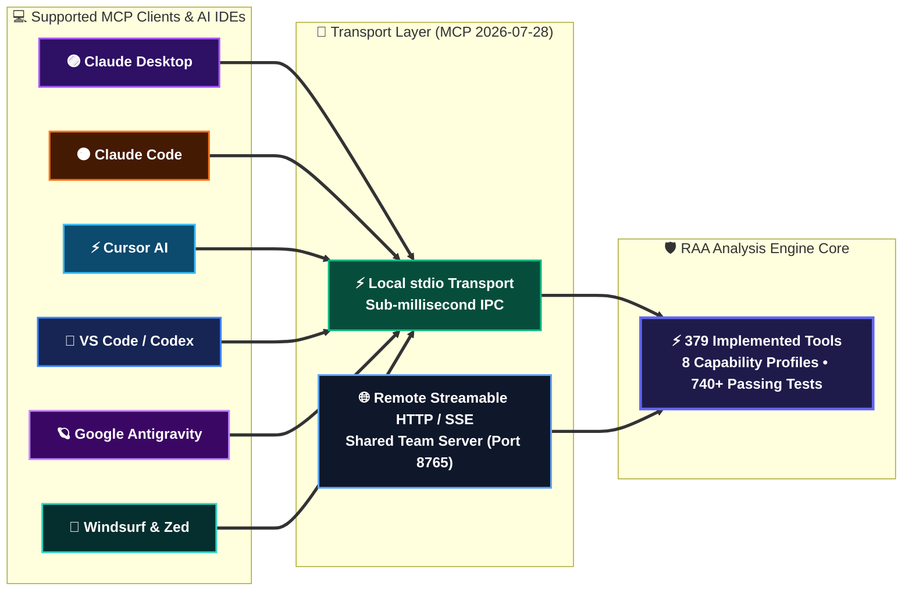

<h1 align="center">RAA — Reverse Android Anything</h1>

<p align="center">
  <strong>Autonomous Mobile Application Intelligence, Next-Gen Decompilation, Living Canvas UI Reconstruction & Offensive Security Operations Platform</strong>
</p>

<p align="center">
  
</p>

<p align="center">
  <a href="RELEASES.md"></a>
  <a href="docs/TOOLS_INTEGRATION_AND_TEST_SCENARIOS.md"></a>
  <a href="docs/CLI_REFERENCE.md"></a>
  <a href="#-verification--quality-gates"></a>
  <a href="LICENSE"></a>
</p>

<p align="center">
  <a href="https://fastapi.tiangolo.com"></a>
  <a href="https://www.python.org"></a>
  <a href="https://modelcontextprotocol.io"></a>
  <a href="https://docs.pydantic.dev"></a>
  <a href="https://typer.tiangolo.com"></a>
  <a href="https://www.docker.com"></a>
  <a href="https://www.sqlite.org"></a>
  <a href="https://developer.android.com"></a>
  <a href="https://developer.apple.com/ios/"></a>
  <a href="https://developer.harmonyos.com"></a>
</p>

<p align="center">
  <a href="#-overview"><strong>Overview</strong></a> •
  <a href="#-core-capabilities"><strong>Core Capabilities</strong></a> •
  <a href="#-tool-registry-379-implemented-tools"><strong>379 Tools</strong></a> •
  <a href="#-specialized-ai-agents--skills"><strong>AI Agents & Skills</strong></a> •
  <a href="#-installation--configuration"><strong>Quickstart</strong></a> •
  <a href="#-frequently-asked-questions-qa"><strong>FAQ</strong></a> •
  <a href="#-documentation--specifications"><strong>Documentation</strong></a>
</p>

---

## 🌟 Overview

**RAA (Reverse Android Anything)** is an autonomous, evidence-first multi-platform application intelligence and offensive security platform. It goes far beyond conventional decompilation: RAA analyzes runtime execution paths, audits Dalvik/native/LLVM binary logic, maps cloud APIs and local datastores, deconstructs view hierarchies, and synthesizes clean, modern **Jetpack Compose** and **React Native** living interfaces.

RAA ingests **APK**, **AAB** (Android App Bundle), **APKS**, **XAPK**, **IPA** (iOS), **HAP** (HarmonyOS), and raw binary shared libraries, inventories container contents, detects frameworks and commercial packers, extracts view hierarchies and API contracts, and produces mathematically verifiable, evidence-backed findings.

### 🎯 Key Architectural Pillars

| Pillar | Capability | Description |
| :--- | :--- | :--- |
| 🤖 **Autonomous AI Agents** | **379 MCP Tools** | Native **Model Context Protocol** integration for Claude Code, Cursor, Antigravity, VS Code, and Codex with verification-gated skills. |
| 🔍 **Next-Gen Decompilation** | **Multi-Engine Core** | Tier-1 integration with JADX, Ghidra, Kuna Rust, RetDec LLVM, and smali bytecode analysis. |
| 🎨 **Living Canvas** | **UI Modernization** | Automated view hierarchy extraction, visual grounding, and semantic synthesis into Jetpack Compose and React Native. |
| 🌐 **API Intelligence** | **Spec Synthesis** | Network AST analysis, dynamic traffic interception with PII scrubbing, OpenAPI 3.1 & Postman v2.1 generation. |
| 🛠️ **Controlled Rebuild** | **RFC Signing** | Live bytecode patching, 16KB page alignment optimization, and RFC-compliant v1/v2/v3 cryptographic APK signing. |
| 🛡️ **Zero-Trust Security** | **Tamper Verification** | Hash-chained append-only audit logs, fail-closed policy engine, and CycloneDX 1.5 cryptographic SBOM generation. |

---

## ⚡ Core Capabilities

The RAA engine operates as an end-to-end analytical pipeline, seamlessly transitioning from container ingestion to autonomous offensive intelligence:

```mermaid
flowchart TB
    subgraph S_INGEST["📥 1. Multi-Platform Container Ingestion"]
        direction LR
        I1["📱 Android APK • AAB • APKS • XAPK"]
        I2["🍎 Apple iOS IPA & Mach-O 64"]
        I3["🌸 HarmonyOS HAP & ArkTS Panda ABC"]
        I4["📦 Native ELF .so & WebAssembly WASM"]
    end

    subgraph S_CORE["⚡ 2. Deep Reverse Engineering Core"]
        direction LR
        C1["🔍 JADX & Ghidra Tier-1 Engines"]
        C2["🕸️ Control-Flow Graphs & AST Recovery"]
        C3["🦀 Kuna Native Rust & RetDec LLVM"]
        C4["⚙️ Dalvik Bytecode & Smali Disassembly"]
    end

    subgraph S_HYBRID["🧩 3. Hybrid Frameworks & Runtimes"]
        direction LR
        H1["💙 Flutter BoringSSL TLS & Dart Strings"]
        H2["⚛️ React Native Hermes Bytecode v96"]
        H3["🎮 Unity IL2CPP C# Metadata Prototypes"]
        H4["🔷 .NET Xamarin Assembly Inspector"]
    end

    subgraph S_STUDIO["🎨 4. Living Canvas & API Studio"]
        direction LR
        U1["📸 Runtime ADB & UIAutomator Capture"]
        U2["🧩 8pt M3 Jetpack Compose & React Native"]
        A1["🌐 Network Client AST & Endpoint Discovery"]
        A2["📜 OpenAPI 3.1 & Postman v2.1 Synthesis"]
    end

    subgraph S_DYN["🚀 5. Dynamic Fleet & Controlled Rebuild"]
        direction LR
        D1["💉 Frida Script Injection & Gadget ELF"]
        D2["📡 Wireless ADB Fleet & BLE GATT Sniffer"]
        R1["✍️ Bytecode Live Patching & 16KB Align"]
        R2["🔏 RFC v1/v2/v3 Signing & Gatekeeper"]
    end

    subgraph S_OPS["🛡️ 6. Autonomous Swarms & Offensive Ops"]
        direction LR
        W1["🤖 41-Agent Mesh & Paperclip Token Budgets"]
        W2["⚔️ Computer-Use GUI (Ghidra, IDA, Burp)"]
        W3["🧪 Non-Destructive Exploit PoC Chaining"]
        W4["🔐 CycloneDX 1.5 SBOM & Tamper Seal"]
    end

    S_INGEST ==> S_CORE
    S_CORE ==> S_HYBRID
    S_HYBRID ==> S_STUDIO
    S_STUDIO ==> S_DYN
    S_DYN ==> S_OPS

    classDef ingest fill:#0A192F,stroke:#00B0FF,stroke-width:2px,color:#FFFFFF,font-weight:bold;
    classDef core fill:#002B20,stroke:#00E676,stroke-width:2px,color:#FFFFFF,font-weight:bold;
    classDef hybrid fill:#1A0033,stroke:#D500F9,stroke-width:2px,color:#FFFFFF,font-weight:bold;
    classDef studio fill:#3E1E00,stroke:#FF9100,stroke-width:2px,color:#FFFFFF,font-weight:bold;
    classDef dyn fill:#00331A,stroke:#00C853,stroke-width:2px,color:#FFFFFF,font-weight:bold;
    classDef ops fill:#33000F,stroke:#FF1744,stroke-width:2px,color:#FFFFFF,font-weight:bold;

    class I1,I2,I3,I4 ingest;
    class C1,C2,C3,C4 core;
    class H1,H2,H3,H4 hybrid;
    class U1,U2,A1,A2 studio;
    class D1,D2,R1,R2 dyn;
    class W1,W2,W3,W4 ops;
```



### 📊 Capabilities Matrix

| Domain | Key Capabilities | Supported Technologies | Representative Tools |
| :--- | :--- | :--- | :--- |
| **🔍 Static Decompilation** | Multi-engine decompilation, AST recovery, call graphs, type reconstruction | JADX, Ghidra, Apktool, RetDec, Kuna Rust | `decompile_source`, `source_cfg_build`, `wasm_decompile` |
| **🧩 Hybrid Runtimes** | TLS unpinning, bytecode disassembly, metadata prototyping | Flutter Dart AOT, React Native Hermes, Unity IL2CPP, .NET | `flutter_dump_strings`, `hermes_disassemble`, `il2cpp_dump_headers` |
| **🎨 Living Canvas UI** | Runtime screen capture, AX-tree pruning, Compose & React generation | UIAutomator, Chrome DevTools (CDP), Material 3, Tailwind | `ui_tree_extract`, `ui_redesign_synthesize`, `ui_theme_extract` |
| **🌐 API & Network** | Endpoint clustering, parameter mutation, 403 bypass, PII sanitization | OpenAPI 3.1, Postman v2.1, Burp Suite MCP, SafeLine WAF | `api_spec_synthesize`, `api_bypass_403_test`, `api_traffic_redact` |
| **⚡ Dynamic Analysis** | Headless display fuzzing, script hooking, BLE sniffer, ADB fleet | Frida, Shizuku IPC, PRoot Linux, mDNS, UPnP, Scapy | `frida_script_inject`, `adb_fleet_discover`, `iot_sniff_traffic` |
| **🛠️ Rebuild & Signing** | Live string/bytecode patching, 16KB page alignment, v1/v2/v3 signing | ZipAlign, apksigner, ELF page-align, Dalvik DexKit | `apk_patch_bytecode`, `elf_align_16kb`, `apk_sign_rfc` |
| **🤖 Swarm Intelligence** | Multi-agent mesh coordination, token budgeting, blackboard state | Paperclip, Ruflo (41 roles), Deer-Flow, MetaGPT | `swarm_org_configure`, `swarm_blackboard_post`, `swarm_budget_set` |
| **⚔️ Offensive Security** | Computer-use GUI agent, MASVS audit, non-destructive PoC validator | Desktop GUI (Ghidra/IDA/Burp), Yaklang, CrowdSec | `gui_computer_use_interact`, `security_audit_masvs`, `cve_chain_poc` |

---

## 🛠️ Tool Registry (379 Implemented Tools)

RAA provides a structured registry of **379 tools** across **8 distinct capability profiles**, designed for flexible agent integration:

<p align="center">
  
  
  
  
  
  
  
  
</p>

| Profile | Tool Count | Primary Use Case & Recommended Agents |
| :--- | :---: | :--- |
| **`minimal`** | **12** | Fast artifact ingestion, manifest triage, and high-level metadata extraction for local or lightweight LLMs. |
| **`core`** | **232** | Static analysis, search-first MCP index, WASM decompiler, toolchain manager, setup wizard, rootless UAD debloat, and class search. |
| **`dynamic`** | **273** | Core tools + Wireless ADB gateway, VirtualDisplay runner, mobile GUI crawler, computer-use operator, and ADB fleet. |
| **`api`** | **234** | Core tools + Burp Suite bridge, rotating proxy gateway, traffic inspector with PII scrubbing, and 403 deep mutator. |
| **`ui`** | **233** | Core tools + Multimodal GUI crawler, Compose modernization, Android TV 10-foot Studio, visual diff, and shaders. |
| **`admin`** | **42** | Zero-trust MCP gateway configurator, Bug Bounty formatter, engine verification, CycloneDX SBOM, and benchmarks. |
| **`swarm`** | **202** | Multi-agent collaborative swarm governance, token budgeting, blackboard coordination, and self-evolving recipes. |
| **`full`** | **379** | Complete, unrestricted superset of all registered capabilities for frontier reasoning agents. |

---

## 🤖 Specialized AI Agents & Skills

RAA coordinates **18 specialized AI agents** (`ALL_SPECIALIZED_AGENTS`) via the **Coverage Tracker Service** (`agent_coverage_get`), supported by **23 discoverable skills** in `skills/`:

```
skills/
├── raa-apk-triage/          # Fast manifest, permissions, framework, and entry activity triage
├── raa-source-reconstruct/  # Full decompilation, control-flow graphs, and AST recovery
├── raa-ui-redesign/         # View hierarchies, runtime capture, and 8pt Compose redesign
├── raa-api-discovery/       # Endpoint clustering, OpenAPI synthesis, and Postman export
├── raa-flutter-reversing/   # Flutter BoringSSL TLS unpinning and Dart string scraping
├── raa-native-reversing/    # JNI function mapping, dynamic symbols, and C/C++ disassembly
├── raa-security-audit/      # MASVS compliance, secret scanning, and privacy data flows
├── raa-app-store-compliance/# App Store & Google Play pre-submission guard and deadline checks
├── raa-controlled-rebuild/  # APK patching, gadget injection, signing, and ADB installation
├── android-triage/          # Fast single-pass APK triage workflow
├── platform-check/          # Host environment, dependencies, and sidecar diagnostics
└── report-and-export/       # Executive Markdown, JSON, and PDF report generation
```

---

## 🚀 Installation & Configuration

> [!TIP]
> **Looking for the complete step-by-step setup guide?**
> Check out the comprehensive **[🚀 RAA Setup & Prerequisites Guide](docs/SETUP_GUIDE.md)** for detailed installation instructions across all operating systems, environment variables, full MCP client configs (Claude Code, Cursor, Antigravity, VS Code, Windsurf), and external engine installation matrices (JADX, Ghidra, Apktool, Frida, RetDec, Kuna Rust).

### Quick Decision Matrix



### 1. Installation Options

<details open>
<summary><strong>⚡ Option A: Instant Zero-Install (Recommended for Quick Runs)</strong></summary>

Execute RAA commands immediately without manually managing Python virtual environments:

```bash
# Using Astral uvx (sub-second execution):
uvx --from . raa --help

# Or via PyPA pipx:
pipx run --spec . raa --help
```

</details>

<details>
<summary><strong>💻 Option B: Local Developer Virtual Environment (Recommended for Contributors)</strong></summary>

```bash
# 1. Clone repository & enter workspace
git clone https://github.com/uditrajput/RAA.git
cd RAA

# 2. Create and activate virtual environment
python -m venv .venv

# On Windows (PowerShell):
.\.venv\Scripts\Activate.ps1
# On Linux / macOS:
source .venv/bin/activate

# 3. Install in editable mode with development dependencies
pip install -e ".[dev]"

# 4. Verify installation
raa --version
```

</details>

<details>
<summary><strong>📦 Option C: Global System Tool Installation</strong></summary>

```bash
# Install as a permanent isolated system tool
uv tool install .

# Or via pipx:
pipx install .
```

</details>

---

### 2. Workspace & Environment Configuration

Initialize the local analysis workspace and configure runtime parameters:

```bash
# Initialize local SQLite workspace (defaults to .raa-workspace/)
raa init

# Copy example environment configuration
cp .env.example .env
```

<details>
<summary><strong>⚙️ Key Environment Variables (Click to expand)</strong></summary>

| Variable | Default | Purpose & Description |
| :--- | :---: | :--- |
| `RAA_WORKSPACE` | `.raa-workspace` | Directory for SQLite DB, evidence, cached DEX, and artifacts. |
| `RAA_PROFILE` | `core` | Active MCP profile (`minimal`, `core`, `dynamic`, `api`, `ui`, `admin`, `swarm`, `full`). |
| `RAA_LOG_LEVEL` | `INFO` | Logging verbosity (`DEBUG`, `INFO`, `WARNING`, `ERROR`). |
| `RAA_LOG_JSON` | `false` | When `true`, outputs JSON logs for observability pipelines. |
| `RAA_API_HOST` | `127.0.0.1` | Bind address for REST API and Streamable HTTP MCP server. |
| `RAA_API_PORT` | `8765` | Network port for HTTP/SSE services. |
| `RAA_API_TOKEN` | *(None)* | Bearer authentication token for securing REST and remote MCP access. |
| `RAA_MAX_INPUT_BYTES` | `2147483648` | Maximum artifact upload/ingest size in bytes (default: 2 GB). |

</details>

---

### 3. AI Coding Agent & IDE MCP Integrations

RAA communicates with all major AI coding environments via the **Model Context Protocol (Protocol 2026-07-28)** using standard I/O (`stdio`) or Streamable HTTP (`SSE`).



#### Automated Setup (One-Click)

Generate configuration automatically for your preferred AI client:

```bash
raa setup --agent claude-desktop
raa setup --agent cursor
raa setup --agent claude-code
raa setup --agent vscode
```

#### Manual IDE Configuration Snippets

<details>
<summary><strong>🟣 Claude Desktop</strong> (<code>claude_desktop_config.json</code>)</summary>

*Path:* `%APPDATA%\Claude\claude_desktop_config.json` (Windows) or `~/Library/Application Support/Claude/claude_desktop_config.json` (macOS)

```json
{
  "mcpServers": {
    "raa": {
      "command": "python",
      "args": ["-m", "raa.cli.main", "--workspace", ".raa-workspace", "--profile", "full", "serve", "mcp"]
    }
  }
}
```

</details>

<details>
<summary><strong>⚡ Cursor</strong> (<code>.cursor/mcp.json</code>)</summary>

*Path:* Project root `.cursor/mcp.json` or Cursor Global Settings:

```json
{
  "mcpServers": {
    "raa": {
      "command": "python",
      "args": ["-m", "raa.cli.main", "--workspace", ".raa-workspace", "--profile", "core", "serve", "mcp"]
    }
  }
}
```

</details>

<details>
<summary><strong>🪐 Google Antigravity IDE</strong> (<code>mcp_config.json</code>)</summary>

*Path:* Global `%USERPROFILE%\.gemini\config\mcp_config.json` or Workspace `.agents/mcp_config.json`:

```json
{
  "mcpServers": {
    "raa": {
      "command": "python",
      "args": ["-m", "raa.cli.main", "--workspace", ".raa-workspace", "--profile", "full", "serve", "mcp"],
      "env": {
        "RAA_LOG_LEVEL": "INFO"
      }
    }
  }
}
```

</details>

<details>
<summary><strong>🔷 VS Code & GitHub Copilot / Codex</strong></summary>

*Path:* `.vscode/settings.json` or User Settings:

```json
{
  "mcp.servers": {
    "raa": {
      "command": "python",
      "args": ["-m", "raa.cli.main", "--workspace", ".raa-workspace", "--profile", "core", "serve", "mcp"]
    }
  }
}
```

</details>

<details>
<summary><strong>🌊 Windsurf & Zed Editor</strong></summary>

*Path:* `~/.codeium/windsurf/mcp_config.json` or Zed `settings.json`:

```json
{
  "mcpServers": {
    "raa": {
      "command": "python",
      "args": ["-m", "raa.cli.main", "--profile", "core", "serve", "mcp"]
    }
  }
}
```

</details>

<details>
<summary><strong>🌐 Remote / Streamable HTTP Server (SSE)</strong></summary>

For shared servers, remote containers, or web-based AI clients:

```bash
# Start RAA MCP in Streamable HTTP / SSE mode:
raa serve mcp --transport sse --host 0.0.0.0 --port 8765
```

Connect using standard SSE URL: `http://<server-ip>:8765/sse`

</details>

---

### 4. 🐳 When is Docker Required?

> [!NOTE]
> **Docker is 100% OPTIONAL for typical RAA workflows.** All 379 core static analysis, decompilation, UI reconstruction, and API synthesis tools run in pure Python without Docker.

```mermaid
flowchart TB
    classDef req fill:#1E293B,stroke:#38BDF8,stroke-width:2px,color:#FFFFFF,font-weight:bold;
    classDef catStatic fill:#065F46,stroke:#34D399,stroke-width:1.5px,color:#ECFDF5,font-weight:bold;
    classDef catUi fill:#0F766E,stroke:#2DD4BF,stroke-width:1.5px,color:#F0FDFA,font-weight:bold;
    classDef catApi fill:#0369A1,stroke:#38BDF8,stroke-width:1.5px,color:#F0F9FF,font-weight:bold;
    classDef catDyn fill:#1D4ED8,stroke:#60A5FA,stroke-width:1.5px,color:#EFF6FF,font-weight:bold;
    classDef catUiSrv fill:#047857,stroke:#6EE7B7,stroke-width:1.5px,color:#ECFDF5,font-weight:bold;
    classDef catCloud fill:#9F1239,stroke:#FB7185,stroke-width:1.5px,color:#FFF1F2,font-weight:bold;
    classDef catMalware fill:#991B1B,stroke:#F87171,stroke-width:1.5px,color:#FEF2F2,font-weight:bold;
    classDef catCluster fill:#9A3412,stroke:#FB923C,stroke-width:1.5px,color:#FFF7ED,font-weight:bold;
    classDef nodock fill:#064E3B,stroke:#10B981,stroke-width:2px,color:#FFFFFF,font-weight:bold;
    classDef dock fill:#881337,stroke:#F43F5E,stroke-width:2px,color:#FFFFFF,font-weight:bold;

    Op["🔍 Analysis / Automation Request"]:::req

    subgraph ZeroDocker["✅ Docker NOT Required — Pure-Python / Host Native"]
        direction TB
        C1["🧬 Static Decompilation & Triage (AXML/DEX/JADX/Ghidra)"]:::catStatic
        C2["🎨 Living Canvas UI (Compose / RN / Android TV Studio)"]:::catUi
        C3["🌐 API Discovery & OpenAPI / Postman Synthesis"]:::catApi
        C4["📱 Physical / Wi-Fi ADB, Frida & Rootless UAD Debloat"]:::catDyn
        C5["🖥️ Setup UI, MCP Server & Telegram/WhatsApp Channels"]:::catUiSrv
        NoDock["⚡ Runs Natively on Host — Zero Docker Needed"]:::nodock
        C1 --> NoDock
        C2 --> NoDock
        C3 --> NoDock
        C4 --> NoDock
        C5 --> NoDock
    end

    subgraph DockerReq["🐳 Docker Strictly Required — Container Isolation"]
        direction TB
        D1["☁️ Headless Cloud Virtual Android (redroid / budtmo)"]:::catCloud
        D2["☣️ Untrusted Malware / Binary Detonation Sandbox"]:::catMalware
        D3["🏢 Multi-Tenant Enterprise CI/CD & K8s Cluster"]:::catCluster
        Dock["🐳 Requires Docker / Container Runtime"]:::dock
        D1 --> Dock
        D2 --> Dock
        D3 --> Dock
    end

    Op --> ZeroDocker
    Op --> DockerReq

    linkStyle 0,1,2,3,4,8 stroke:#10B981,stroke-width:2px;
    linkStyle 5,6,7,9 stroke:#F43F5E,stroke-width:2px;
```



#### ✅ When Docker is NOT Required (Zero-Docker Local / Pure-Python Mode)

| Scenario | Workflow / Capability | Execution Mode |
| :---: | :--- | :--- |
| **1** | **Static Decompilation & Triage** | Pure-Python AXML/ARSC/DEX parsing, JADX/Ghidra/Kuna/RetDec sidecars, and OWASP MASVS static rules run natively on your host. |
| **2** | **Living Canvas UI & Code Synthesis** | Runtime view hierarchy capture, Jetpack Compose / React Native reconstruction, Android TV 10-foot redesign, and visual screendiff run locally. |
| **3** | **API Discovery & Spec Synthesis** | Network client AST extraction, OpenAPI 3.1 / Postman v2.1 generation, and 403/BOLA fuzzing run without containers. |
| **4** | **Physical / Wi-Fi ADB, Frida & UAD Debloat** | Connected phones, tablets, and Android TVs (USB or Wireless ADB), Frida hooking, and rootless `raa debloat` run directly against your device. |
| **5** | **Setup UI, MCP Server & Mobile Channels** | FastAPI Setup & Tool Manager UI (`raa setup-ui`), `stdio`/HTTP MCP server, and Telegram/WhatsApp gateways run natively. |

#### 🐳 When Docker IS Strictly Required

Docker is **strictly required only** in the following 3 conditions:

| Scenario | Condition | Docker Tool / Image |
| :---: | :--- | :--- |
| **1** | **Headless Virtual Android Emulators** | When running dynamic tests without physical Android hardware connected (`docker_android_run`, using `budtmo/docker-android` or `redroid/redroid`). |
| **2** | **Untrusted Malware Sandboxing** | When executing untrusted binary payloads or aggressive runtime hooking in an isolated sandbox (`docker_sandbox_exec`). |
| **3** | **Cloud Multi-Tenant CI/CD Fleets** | When running RAA inside enterprise Kubernetes or containerized microservices to guarantee zero-residue workspace isolation. |

---

### 5. Starting Services & Health Verification

```bash
# 1. Verify environment, sidecars, and dependencies
raa doctor

# 2. Start REST API (Swagger UI at http://127.0.0.1:8765/docs)
raa serve api --host 127.0.0.1 --port 8765

# 3. Start interactive MCP server (stdio)
raa serve mcp
```

---

## 💻 Quick Start: CLI Workflows

```powershell
# 1. Ingest an APK and create a project
raa project create "My Analysis Project"
raa artifact ingest prj_xxx /path/to/target.apk

# 2. Inspect Manifest & Search Bytecode
raa manifest inspect prj_xxx art_xxx
raa source search prj_xxx "AuthToken"

# 3. Synthesize OpenAPI 3.1 Specification and Export Postman Collection
raa api synthesize prj_xxx art_xxx
raa api postman prj_xxx art_xxx --output ./postman_collection.json

# 4. Extract UI, Capture Runtime Screen & Generate Jetpack Compose Redesign
raa ui tree prj_xxx art_xxx
raa ui redesign prj_xxx screen_main --framework compose

# 5. Verify Tamper-Evident Audit Trail & Generate CycloneDX SBOM
raa admin audit-verify
raa admin sbom --format cyclonedx

# 6. Backup Project for Disaster Recovery
raa admin backup prj_xxx --output ./backup.raa.bundle.tar.gz
```

---

## ❓ Frequently Asked Questions (Q&A)

<details>
<summary><strong>1. Who is legally responsible for using RAA to analyze applications?</strong></summary>
<br>

**The end-user bears 100% sole legal liability.** The developers, authors, maintainers, and contributors of RAA accept no responsibility, obligation, or liability of any kind for any legal consequences, damages, civil suits, regulatory penalties, or criminal charges arising from your use or misuse of this tool. You must ensure you have explicit written authorization before analyzing, decompiling, or intercepting any target software or hardware.

</details>

<details>
<summary><strong>2. What platforms, package formats, and architectures does RAA support?</strong></summary>
<br>

RAA is a universal application reversing platform supporting:
- **Android:** APK, Android App Bundle (AAB), split APK sets (APKS), and XAPK archives across ARM64, ARMv7, x86, and x86_64.
- **Apple iOS:** Application containers (`.ipa`), 64-bit Mach-O binaries, FairPlay DRM audit (`cryptid`), Info.plist permissions, and PKCS#7 signed embedded provisioning profiles.
- **Huawei HarmonyOS & OpenHarmony:** `.hap` packages, Stage (`module.json`) and FA (`config.json`) application models, and ArkTS Panda ABC bytecode (`classes.abc`).

</details>

<details>
<summary><strong>3. How does RAA connect with AI Coding Agents (Claude Code, Cursor, Antigravity, VS Code)?</strong></summary>
<br>

RAA natively implements the **Model Context Protocol (MCP)** specification. You can run RAA as a local MCP server over standard input/output (`stdio`) or as a networked background server over Streamable HTTP (`FastMCP`). AI agents discover all 377 registered tools with their complete JSON Schema inputs and execute end-to-end reversing, security audits, and UI reconstruction autonomously.

</details>

<details>
<summary><strong>4. Can RAA be used completely offline in air-gapped secure labs?</strong></summary>
<br>

**Yes, absolutely.** RAA is engineered with a strict local-first, zero-egress architecture. All core analysis routines, Dalvik/DEX parsing, Mach-O inspection, and ABC bytecode disassembly are written in pure Python with zero external network dependencies. No telemetry or data is ever transmitted outside your local machine.

</details>

<details>
<summary><strong>5. How does RAA prevent unauthorized or accidental modifications to devices?</strong></summary>
<br>

RAA enforces a **fail-closed security policy engine**. Potentially hazardous operations (such as binary patching, code injection, or device mutation) require explicit project-level scope grants (e.g., `android.patch`, `dynamic.hook`, `dynamic.device`). Any operation lacking the authorized scopes fails closed with a `PolicyDeniedError` before execution. In addition, all tool invocations are permanently cryptographically recorded in an append-only, hash-chained audit log.

</details>

<details>
<summary><strong>6. What are the 8 capability profiles and what tools do they expose?</strong></summary>
<br>

RAA uses capability profiles to tailor tool exposure to specific agents and contexts:
- <code>minimal</code> (12 tools): Essential triage and summary tools for lightweight models.
- <code>core</code> (232 tools): Static analysis, source inspection, frameworks, toolchain manager, setup wizard, UAD debloat & offensive triage.
- <code>dynamic</code> (273 tools): Runtime ADB, Wireless Wi-Fi gateway, Frida instrumentation, computer-use GUI & live network interception.
- <code>api</code> (234 tools): API reverse-engineering, spec synthesis, and threat intelligence.
- <code>ui</code> (233 tools): View hierarchy extraction, visual grounding, Compose/React reconstruction, Android TV Studio & shaders.
- <code>admin</code> (42 tools): Cryptographic audit verification, doctor, SBOM, ZTNA gateways & tamper seals.
- <code>swarm</code> (202 tools): Multi-agent swarm governance, token budgeting, blackboard, self-evolving recipes & SOP execution.
- <code>full</code> (379 tools): Complete, unrestricted tool catalog for frontier models.

</details>

<details>
<summary><strong>7. Does RAA require root access on connected Android devices?</strong></summary>
<br>

**No, root is not mandatory.** While rooted devices unlock full kernel tracing and raw socket capture, RAA supports non-rooted workflows using:
- Privileged operations via the **Shizuku IPC Bridge** (<code>shizuku_privileged_exec</code>).
- Standalone userspace Linux containers via **Termux PRoot** (<code>termux_proot_workspace_manage</code>).
- Virtual headless fuzzing via **VirtualDisplay** and **Docker-Android** emulators.

</details>

<details>
<summary><strong>8. How does the UI Reconstruction engine generate code from screenshots?</strong></summary>
<br>

RAA extracts runtime view hierarchies via ADB or Chrome DevTools Protocol (CDP), prunes the accessibility tree (AX-tree), clusters styling properties (typography, paddings, colors) against an 8pt design system, and synthesizes production-ready **Jetpack Compose** (Android) or **React Native** code with perceptual visual diff verification.

</details>

---

## 🧪 Verification & Quality Gates

RAA maintains a strict 100% test pass rate and zero-lint compliance across all releases:

```powershell
# Run the complete test suite (740+ tests across all 21 phases)
python -m pytest -v

# Run linting and code style checks
python -m ruff check src tests
python -m ruff format --check src tests

# Run static type verification
python -m mypy src
```

---

## 📚 Documentation & Specifications

All in-depth architectural guides, full capability matrices, CLI references, and operational deployment documentation are maintained in the **[Documentation Hub](docs/README.md)**:

| Category | Document | Description |
| :--- | :--- | :--- |
| 📖 **Portal** | **[Documentation Hub](docs/README.md)** | Central navigation portal for the entire RAA knowledge base. |
| 💻 **CLI** | **[Complete CLI Reference Guide](docs/CLI_REFERENCE.md)** | Exhaustive reference of all **345 CLI commands** across 38 subcommand groups. |
| 🛠️ **Tools** | **[Tools Integration & Test Scenarios](docs/TOOLS_INTEGRATION_AND_TEST_SCENARIOS.md)** | Complete matrix of all **379 tools**, profiles, requirements, and test scenarios. |
| 📦 **Releases** | **[Release History & Changelog](RELEASES.md)** | Comprehensive release notes and version progression through **v4.0.0 Production**. |
| 📋 **Milestone** | **[v4.0.0 Production Notes](releases/RELEASE_v4.0.0.md)** | Announcement of self-evolving skills, Setup UI, Mobile Agent, MCP Mesh, Wireless Gateway & Android TV Studio. |
| 🏛️ **Architecture** | **[System Architecture](docs/ARCHITECTURE.md)** | Subsystem topology, single-core runtime flow, and multi-platform adapters. |
| 🎨 **Design** | **[System Design & Specification](docs/DESIGN.md)** | Evidence-first truth hierarchy, domain entities, 8pt UI system, and MCP contracts. |
| 🤖 **Agents** | **[Specialized Agents & Skills](docs/AGENTS_AND_SKILLS.md)** | Multi-agent swarm orchestration, 18 specialized agents, and 23 skills. |
| 🚀 **Roadmap** | **[Strategic Roadmap](docs/ROADMAP.md)** | Future roadmap and capability progression milestones. |
| 🏢 **Deployment** | **[Enterprise Deployment Guide](docs/DEPLOYMENT.md)** | Production hardening, Docker sandboxing, multi-tenancy quotas, and air-gapped setups. |
| 🔒 **Security** | **[Security Architecture & Threat Model](docs/SECURITY.md)** | STRIDE threat modeling, fail-closed policy engine, and SHA-256 audit trails. |
| 🚀 **Setup** | **[Setup & Installation Guide](docs/SETUP_GUIDE.md)** | Step-by-step setup guide for MCP clients and analysis engines. |
| ⚙️ **DevOps** | **[CI/CD Architecture](docs/devops/CI_CD_ARCHITECTURE.md)** | Automated testing, linting, and quality pipeline. |
| 🛡️ **SAST** | **[Security Scanning & SAST](docs/devops/SECURITY_SCANNING.md)** | Semgrep, CodeQL, and dependency vulnerability scanning. |
| 🔄 **Workflow** | **[Contribution Workflow](docs/devops/CONTRIBUTION_WORKFLOW.md)** | Git flow, branch protection, and PR guidelines. |

---

## ⚖️ License & Legal Disclaimer

### Limitation of Liability & User Responsibility

> [!CAUTION]
> **LEGAL DISCLAIMER & LIMITATION OF LIABILITY — PLEASE READ BEFORE USE**
>
> **The developers, creators, maintainers, and contributors of RAA accept NO legal responsibility or liability of any kind for any damages, legal actions, criminal or civil liabilities, service disruptions, or copyright/intellectual property infringements resulting from the use or misuse of this software.**
>
> **The end-user is exclusively liable and bears 100% legal responsibility for all actions performed with RAA. You must independently verify and ensure full compliance with all applicable local, national, and international laws, regulations, terms of service, and authorization requirements before inspecting, decompiling, analyzing, modifying, or intercepting any application or device.**
>
> For full security and compliance policies, refer to [SECURITY.md](docs/SECURITY.md).

### License

This project is licensed under the **MIT License**. See the [LICENSE](LICENSE) file for complete details.

---
