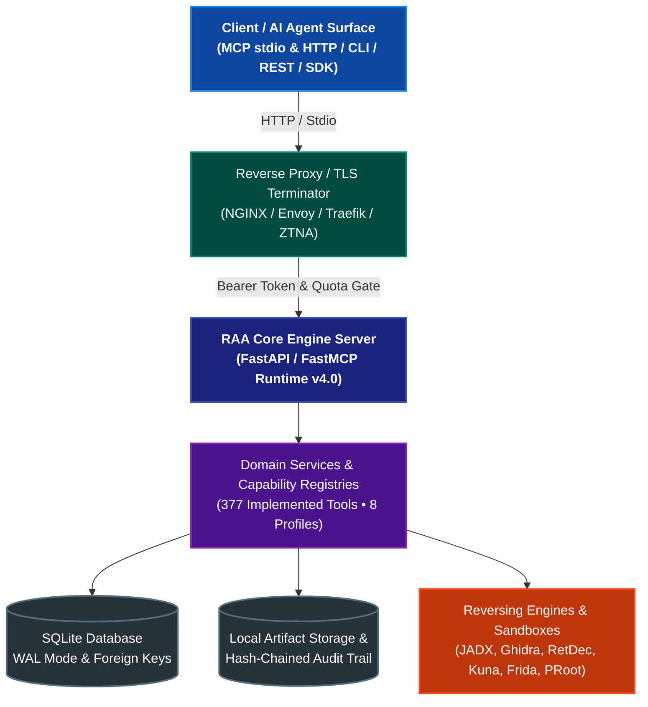

# RAA Enterprise Deployment & Production Hardening Guide

<p align="center">
  
</p>

<p align="center">
  
  
  
</p>
<p align="center">
  
  
</p>

This document details enterprise deployment topologies, multi-tenancy configuration, security hardening, air-gapped installation, and disaster recovery procedures for **RAA (Reverse Android Anything)**.

---

## 1. Deployment Topologies

RAA is built as a unified single-engine core exposed across four interoperable surfaces:
- **MCP (Model Context Protocol):** Streamable HTTP and stdio servers for AI coding agents (Claude Code, Antigravity, Cursor, Codex).
- **REST API:** High-throughput FastAPI application with production security headers, rate limiting, and OpenAPI 3.1 documentation.
- **CLI:** Native Typer CLI for automated CI/CD pipelines, container scripts, and analyst terminal workflows.
- **Python SDK:** Direct programmatic integration for custom scripting.



---

## 2. Multi-Tenancy & Resource Quotas

RAA includes built-in multi-tenancy management via `TenancyService` in `src/raa/services/tenancy.py`.

### Tenant Profiles

| Tenant Tier | Max Projects | Max Storage | Max Concurrent Jobs | Description |
| :--- | :---: | :---: | :---: | :--- |
| **Default Enterprise** (`default`) | 500 | 100 GB | 20 | Unrestricted enterprise tier with priority scheduling. |
| **Community / Free** (`free`) | 5 | 500 MB | 2 | Rate-limited sandbox tier for evaluators. |
| **Custom Enterprise** | Configurable | Configurable | Configurable | Custom quotas defined per organization. |

Quota limits are strictly enforced on `POST /v1/projects`, artifact ingestion, and asynchronous background jobs. When a quota threshold is reached, RAA returns a `429 / limit_exceeded` error with an actionable remediation hint.

---

## 3. Production Security & Hardening

### 3.1 Security Headers
The REST surface automatically injects production security headers on all responses:
- `X-Content-Type-Options: nosniff` (Prevents MIME-sniffing attacks)
- `X-Frame-Options: DENY` (Mitigates clickjacking)
- `Referrer-Policy: strict-origin-when-cross-origin` (Protects sensitive request context)
- `X-XSS-Protection: 1; mode=block` (Legacy browser XSS filtering)

### 3.2 Authentication & Authorization
- **Bearer Token Authentication:** Gated via `api_token` in `Settings`. All `/v1/` routes require valid authorization headers (`Authorization: Bearer <token>`).
- **Fail-Closed Policy Engine:** Mutation, dynamic device leasing, ELF injection, and rebuild tools require explicit scope grants (`android.patch`, `dynamic.device`, `project.write`). Tools operating outside granted scopes fail closed immediately.

---

## 4. Tamper-Resistant Audit Trail

All tool executions across CLI, REST, and MCP surfaces are recorded in an append-only, hash-chained log (`.raa-workspace/audit/audit.jsonl`).

### Hash Chaining Mechanism
Each record is cryptographically linked to the previous entry:
$$\text{record\_hash} = \text{SHA-256}(\text{prev\_hash} \parallel ":" \parallel \text{canonical\_payload})$$

- **Genesis Anchor:** Initial entry anchors to 64 zeros (`0000...0000`).
- **Zero Raw Secret Exposure:** Argument values are never stored raw; only canonical parameter keys and a SHA-256 digest of arguments are recorded.
- **Integrity Verification:** The `admin_audit_verify` tool scans the full log from genesis to head, verifying every hash link. Any record modification, insertion, or deletion is detected with line-level precision:
  ```powershell
  raa admin audit-verify
  ```

---

## 5. Software Bill of Materials (SBOM)

RAA provides native, automated SBOM generation in both **CycloneDX v1.5** and **SPDX 2.3** formats:

```powershell
# Generate CycloneDX JSON
raa admin sbom --format cyclonedx

# Generate SPDX 2.3 JSON
raa admin sbom --format spdx
```

The generated SBOM catalogs:
- All installed Python dependencies and runtime packages with standardized PURLs.
- Catalogued reverse-engineering engines (JADX, Apktool, Ghidra, Rizin, Cutter, Frida, Syft, Grype).
- Component license IDs, distribution classes, and integrity digests.

---

## 6. Disaster Recovery: Backup, Restore & Retention

### 6.1 Project Backup
Export any project, including its database records, metadata, ingested artifacts, and evidence files, into a portable `.raa.bundle.tar.gz` archive:
```powershell
raa admin backup <project_id> --output /backup/path/my_project.raa.bundle.tar.gz
```

### 6.2 Project Restore
Restore a project archive into an active workspace with cryptographic checksum validation:
```powershell
raa admin restore /backup/path/my_project.raa.bundle.tar.gz --name "Restored Enterprise App"
```

### 6.3 Data Retention Policy Enforcement
Automatically prune temporary backup archives and expired cache files older than a specified number of days:
```powershell
raa admin retention --days 30
```

---

## 7. Air-Gapped / Isolated Installation

In secure enterprise environments without internet access:
1. **Pre-cache Python Wheels:**
   ```bash
   pip download -r requirements.txt -d ./wheels
   pip install --no-index --find-links=./wheels raa
   ```
2. **Offline Engine Packs:**
   Place native engine sidecars (`jadx`, `apktool`, `ghidra`, `rizin`) into `sidecars/` or add them to the system `PATH`.
3. **Verify Environment Readiness:**
   ```powershell
   raa doctor
   raa admin engines
   ```
