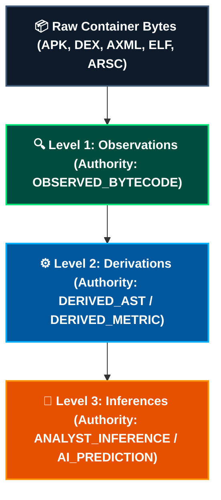
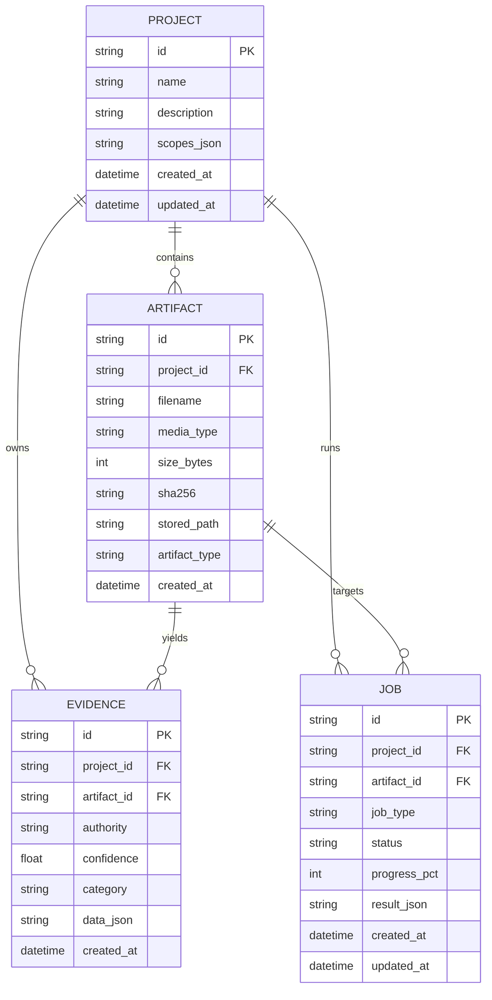

# RAA System Design & Specification

  

  
  
  

  
  

This document details the engineering specifications, domain models, truth hierarchy, design systems, and protocol contracts implemented across **RAA (Reverse Android Anything)**.

---

## 1. Evidence-First Truth Model

RAA enforces a strict data provenance hierarchy to prevent AI hallucinations and ensure that reverse-engineered facts are separated from inferences.

### Authority Levels

| Authority Level | Definition | Example Artifacts |
| :--- | :--- | :--- |
| **`OBSERVED_BYTECODE`** | Direct raw extractions from binary streams without semantic interpretation. | Dalvik opcodes, ELF dynamic symbol strings, AXML attribute integers, certificate fingerprints. |
| **`DERIVED_AST`** | Deterministically synthesized representations produced by deterministic compilers/engines. | Control-flow graphs (CFGs), Java ASTs, OpenAPI parameterized paths, decompiled Smali blocks. |
| **`ANALYST_INFERENCE`** | Heuristic, statistical, or AI-synthesised deductions. Must carry confidence ratings. | Inferred REST entity models, predicted screen transitions, deobfuscated variable name suggestions. |

Every piece of evidence stored in the SQLite `evidence` repository records:
- `id`: Opaque, prefixed identifier (`evi_...`).
- `artifact_id`: Source container hash reference.
- `authority`: One of the formal authority tiers.
- `confidence`: Decimal score between `0.0` and `1.0`.
- `representation`: Concrete data structure (JSON, AST, text).

---

## 2. Policy & Security Scope System

RAA's security model is **fail-closed**: access is denied unless an operation is explicitly permitted by granted scopes.

### Scope Taxonomy

```mermaid
flowchart TD
    classDef safe fill:#004D40,stroke:#00E676,stroke-width:2px,color:#FFFFFF,font-weight:bold;
    classDef safenode fill:#0D47A1,stroke:#1E88E5,stroke-width:1px,color:#FFFFFF;
    classDef priv fill:#880E4F,stroke:#FF1744,stroke-width:2px,color:#FFFFFF,font-weight:bold;
    classDef privnode fill:#311B92,stroke:#7C4DFF,stroke-width:1px,color:#FFFFFF;

    Safe["🛡️ Safe / Baseline Scopes (Default)"]:::safe --> PR["project.read"]:::safenode
    Safe --> PW["project.write"]:::safenode
    Safe --> SR["static.read"]:::safenode
    Safe --> EW["export.write"]:::safenode
    
    Priv["⚠️ Dangerous / Privileged Scopes (Opt-in Explicit Grant)"]:::priv --> ER["export.raw"]:::privnode
    Priv --> DD["dynamic.device"]:::privnode
    Priv --> DI["dynamic.instrument"]:::privnode
    Priv --> NC["network.capture / osint / crawl / fetch"]:::privnode
    Priv --> AI["android.install"]:::privnode
    Priv --> AP["android.patch"]:::privnode
    Priv --> AS["android.sign"]:::privnode
    Priv --> LE["llm.external"]:::privnode
    Priv --> ADM["admin"]:::privnode
```

1. **`project.read`:** Read project metadata, artifacts, and summary reports (default).
2. **`project.write`:** Mutate projects, ingest new artifacts, and restore backups (default).
3. **`static.read`:** Read decompiled code, manifest structures, resources, and strings (default).
4. **`export.write`:** Generate OpenAPI specifications, Postman collections, and UI wireframes (default).
5. **`export.raw`:** Export raw decompiled source trees and unredacted binary dumps.
6. **`dynamic.device`:** Connect to ADB daemons, acquire device leases, and capture screens.
7. **`dynamic.instrument`:** Deploy Frida scripts, attach to processes, and instrument runtime calls.
8. **`network.capture` / `network.osint` / `network.crawl` / `network.fetch`:** Capture live traffic, query OSINT, crawl endpoints, and fetch remote binaries/MCP resources.
9. **`android.install` / `android.patch` / `android.sign`:** Install, patch Dalvik/AXML bytecode, and sign rebuilt APK/AAB containers.
10. **`llm.external` / `admin`:** Dispatch to external LLM harnesses and perform administrative operations (engine catalog, audit verify, SBOM, backup/restore).

---

## 3. UI Reconstruction & Design System Engine

The UI engine in `src/raa/services/android/ui_design_system.py` converts extracted layout hierarchies into high-fidelity, accessible mobile interfaces.

### Core Design Principles

1. **8-Point Spatial Grid:**
   All margins, paddings, element heights, and component dimensions snap to multiples of 8dp (`8dp`, `16dp`, `24dp`, `32dp`, `48dp`). Small icon adjustments allow 4dp increments.
2. **Thumb-Zone Optimization:**
   Interactive buttons, primary navigation, and input triggers are positioned in the bottom 40% of the screen ("easy thumb reach"). Destructive or secondary controls are isolated at the top.
3. **60/30/10 Color Rule:**
   - **60% Dominant (Background & Canvas):** Clean surface background (light `#FFFFFF` or dark `#121212`).
   - **30% Structural (Cards, Dividers, Surfaces):** Subtle contrast layer.
   - **10% Accent (CTAs, Badges, Highlights):** High-contrast primary action color.
4. **Touch Target Dimensions:**
   All touchable targets adhere to Material / WCAG minimums of at least **$48 \times 48\text{ dp}$**.
5. **Multi-Target Code Synthesis:**
   Generates clean, idiomatic code for:
   - **Jetpack Compose** (Kotlin with Material 3 styling)
   - **React Native** (TypeScript with StyleSheet)
   - **Flutter** (Dart with Material widgets)
   - **Tailwind CSS** (HTML5 for rapid prototyping)

---

## 4. API Reverse Engineering Studio Design

The API extraction engine in `src/raa/services/android/api_studio.py` recovers backend specifications through static AST analysis and dynamic proxy clustering.

### Processing Pipeline
1. **Endpoint Harvesting:** Regex and AST scanners extract URL strings and `@GET`, `@POST`, `@Path` annotations from Retrofit, OkHttp, Ktor, and Volley clients.
2. **Path Parameterization:** Heuristic clustering converts literal paths (`/v1/users/123/orders/99`) into normalized path templates (`/v1/users/{user_id}/orders/{order_id}`).
3. **Header & Auth Inference:** Analyzes headers to determine authentication schemes (Bearer JWT, OAuth2, API Key in Header).
4. **Schema Synthesis:** Converts observed query parameters, form fields, and JSON payloads into valid OpenAPI 3.1 parameter and schema objects.
5. **Artifact Generation:**
   - **OpenAPI 3.1 Document:** Complete Swagger-compatible API documentation.
   - **Postman Collection v2.1:** Runnable collection containing requests, sample headers, dynamic `{{base_url}}` variables, and test assertion scripts.

---

## 5. Storage Schema & Database Design

RAA uses an embedded SQLite database configured with **WAL (Write-Ahead Logging)** mode for concurrent readers.

---

## 6. Platform Compatibility Design

### Windows Sandbox Event Loop Workaround
On Windows inside network-restricted sandboxes (`BypassSandbox: false`), standard Python `asyncio.ProactorEventLoop` hangs indefinitely because its internal self-pipe calls `socket.socketpair()`, which attempts a TCP loopback connect to `127.0.0.1`. In sandboxed Windows environments, outbound TCP connect is denied by kernel security (`WinError 10013`).

RAA resolves this via `src/raa/compat.py`:
- Probes loopback socket connectivity on module import.
- If loopback connections are blocked by sandbox isolation, it equips `BaseProactorEventLoop` with a non-blocking dummy self-pipe (`_DummyLoopbackSocket`).
- Ensures RAA's CLI and test suite execute in **< 2 seconds** with zero stalls on any platform or sandboxed runner.
