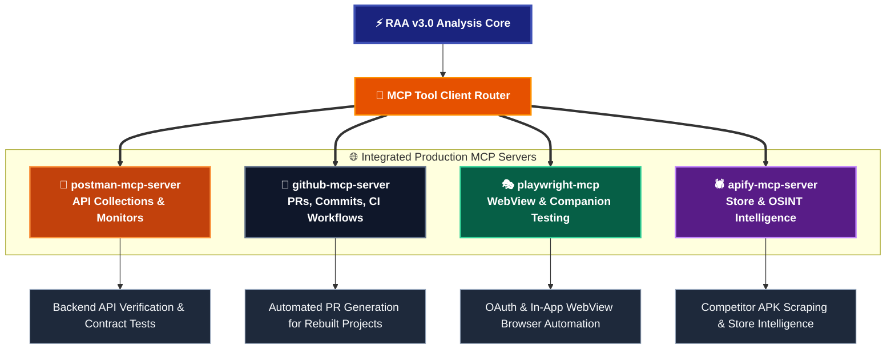

# RAA v4.0.0 Enhancement Plan & Strategic Roadmap
## Autonomous Self-Evolving Mobile Intelligence, Interactive Setup UI & Wireless Operations

<p align="center">
  
</p>

<p align="center">
  
  
  
  
  
</p>

---

## 1. Executive Roadmap & Vision

RAA (Reverse Android Anything) has achieved production maturity in **v2.0.0** (Phases 0 through 14), featuring **244 implemented tools**, 7 operational capability profiles, 11 discoverable agent skills, and universal platform support spanning Android APK/AAB, Apple iOS IPA & 64-bit Mach-O, Huawei HarmonyOS HAP & ArkTS Panda ABC, and rootless on-device PRoot Linux containers.

The **v3.0.0 Enhancement Plan** represents an architectural paradigm shift: transitioning RAA from a single-agent reverse-engineering platform into an **Autonomous Multi-Agent Swarm, Enterprise Application Intelligence, and Offensive Security Operations Mesh**.

```mermaid
flowchart LR
    classDef v1 fill:#1B5E20,stroke:#43A047,stroke-width:2px,color:#FFFFFF;
    classDef v2 fill:#00695C,stroke:#00897B,stroke-width:2px,color:#FFFFFF;
    classDef v21 fill:#0D47A1,stroke:#1E88E5,stroke-width:2px,color:#FFFFFF;
    classDef v22 fill:#311B92,stroke:#5E35B1,stroke-width:2px,color:#FFFFFF;
    classDef v23 fill:#4A148C,stroke:#8E24AA,stroke-width:2px,color:#FFFFFF;
    classDef v24 fill:#E65100,stroke:#FB8C00,stroke-width:2px,color:#FFFFFF;
    classDef v25 fill:#BF360C,stroke:#F4511E,stroke-width:2px,color:#FFFFFF;
    classDef v30 fill:#FF6F00,stroke:#FFA000,stroke-width:3px,color:#FFFFFF,font-weight:bold;

    subgraph Baseline["🏆 Foundation Milestones (v1.0 & v2.0)"]
        direction TB
        V1["<b>Phase 0–10 (v1.0 Delivered)</b><br/>• Core Static Analysis & JADX<br/>• UI Redesign & Jetpack Compose<br/>• Dynamic Frida Instrumentation<br/>• Framework Adapters & API Studio"]:::v1
        V2["<b>Phase 11–14 (v2.0 Delivered)</b><br/>• Enterprise Hardening & Quotas<br/>• RFC v1/v2/v3 Signing & 16KB Align<br/>• Universal iOS Mach-O & HarmonyOS<br/>• On-Device PRoot Linux Containers"]:::v2
    end

    subgraph Expansion["🚀 Swarm & Intelligence Evolution"]
        direction TB
        V21["<b>Phase 15 (v2.1 Delivered)</b><br/>• Paperclip Swarm Governance<br/>• Ruflo Multi-Agent Mesh (41 Roles)<br/>• Deer-Flow Long-Horizon Engine<br/>• Edict Tri-Chamber Veto Gates"]:::v21
        V22["<b>Phase 16 (v2.2 Delivered)</b><br/>• Dual-Context Adversarial Audit<br/>• Google ADK Workflow Generator<br/>• In-App Billing Intel Engine<br/>• QuantDinger Exploit Payoff"]:::v22
        V23["<b>Phase 17 (v2.3 Delivered)</b><br/>• Kuna Native Rust Decompiler<br/>• Malimite Apple Reversing Engine<br/>• Physical Lockscreen Bypass<br/>• Nanobot Daemons & Offline Vault"]:::v23
    end

    subgraph Production["⭐ Production v3.0 Milestone"]
        direction TB
        V24["<b>Phase 18 (v2.4 Delivered)</b><br/>• Google Stitch UI Studio M3<br/>• Apple HIG Doctor & Liquid Glass<br/>• Ekko Workflow Canvas & Sodu CI/CD<br/>• Multi-Viewport Visual Diffing"]:::v24
        V25["<b>Phase 19 (v2.5 Delivered)</b><br/>• Enterprise MCP Mesh (Postman/GH/Apify)<br/>• Universal 7-CLI Gateway<br/>• WASM Sandboxed Plugin Runtime<br/>• Forensic Mutation Digest Guard"]:::v25
        V30["<b>Phase 20 (v3.0.0 Production Gold)</b><br/>• Yaklang HackSkills Suite<br/>• Computer-Use GUI Operator<br/>• Non-Destructive Exploit PoC Chaining<br/>• 322 Tools • 526 Passing Tests • Seal"]:::v30
    end

    Baseline --> Expansion --> Production
```



---

## 2. Comprehensive Research & Architectural Benchmark (45 Projects)

A systematic research audit was conducted across 45 frontier open-source projects, extracting key paradigms, tools, and capabilities applicable to RAA's mission:

| # | Repository & Ecosystem | Tech Stack | Core Capabilities | Reusable Innovation for RAA | Strategic Adoption |
| :--- | :--- | :--- | :--- | :--- | :---: |
| **1** | **Paperclip**<br>`paperclipai/paperclip` | Node.js, React, PostgreSQL | Zero-human AI company control plane, org charts, budget governance, heartbeat scheduling | **Autonomous Swarm Control Plane & Token Budgeting:** Provides hierarchical org charts, token spend limits, and heartbeat wakeups for RAA multi-agent audits. | **ADOPTED** |
| **2** | **Deer-Flow 2.0**<br>`bytedance/deer-flow` | Python, Docker, LangGraph | Long-horizon SuperAgent harness, recursive subagent delegation, persistent scratchpad | **Long-Horizon Deep-Research & Recursive Exploration Subagent:** Powers multi-hour reversing runs across large multi-gigabyte APKs with sandboxed scratchpads. | **ADOPTED** |
| **3** | **Ruflo**<br>`ruvnet/ruflo` | Python, RuVector, Multi-Agent Mesh | Meta-harness, multi-player swarms, adaptive self-learning memory, cross-machine federation | **Cross-Machine Distributed Swarm Federation & Adaptive Memory:** Enables distributed swarm nodes across analyst workstations and physical device test farms. | **ADOPTED** |
| **4** | **MetaGPT**<br>`FoundationAgents/MetaGPT` | Python, Multi-Agent Role SOPs | Multi-agent software company role simulation (PM, Architect, Engineer, QA), standardized operating procedures | **Multi-Agent Reverse-Engineering SOP Pipeline:** Formalizes decompilation, UI reconstruction, and vulnerability verification into deterministic SOPs. | **ADOPTED** |
| **5** | **AI Agent Book**<br>`bojieli/ai-agent-book` | Python, Cognitive Architectures | Architectural patterns, dual-system reasoning (System 1 vs System 2), reflection loops | **Cognitive Architecture & Dynamic Reversing Strategy Selector:** Adapts agent thinking depth based on APK obfuscation level and packing complexity. | **ADOPTED** |
| **6** | **CowAgent**<br>`zhayujie/CowAgent` | Python, MCP, Long-Term Memory | Proactive personal AI assistant, task planning, MCP integration, self-evolving memory | **Proactive Background App Analyst & Long-Term Memory Evolution:** Continuously analyzes newly dropped APKs and evolves heuristics from past investigations. | **ADOPTED** |
| **7** | **Nanobot**<br>`HKUDS/nanobot` | Python, MCP, Telegram/Slack | Ultra-lightweight self-hosted personal agent, cron/heartbeat automation, chat bridges | **Headless Lightweight Daemon & Remote Notification Bridge:** Dispatches critical vulnerability alerts and build status updates to Telegram, Slack, and Discord. | **ADOPTED** |
| **8** | **Agents**<br>`wshobson/agents` | Markdown Specs, Multi-Harness | Universal modular agent plugins dynamically adapted across Claude Code, Codex, Cursor, Antigravity | **Universal Agent Specification & Cross-Harness Skill Adapter:** One canonical `AGENT.md` format that automatically compiles for any target coding harness. | **ADOPTED** |
| **9** | **Codewhale**<br>`codewhale-hq/Codewhale` | Rust, Ratatui, Tokio | High-performance terminal coding agent, subagent task sharding, cryptographic execution receipts | **High-Performance Native TUI & Signed Execution Receipts:** Ultra-responsive terminal UI with SHA-256 signed receipts for forensic chain-of-custody. | **ADOPTED** |
| **10** | **Vibe-Trading**<br>`HKUDS/Vibe-Trading` | Python, Multi-Agent Finance | Quantitative alpha modeling, multi-agent financial workspace, risk controls | **In-App Purchase (IAP), Billing & Monetization Intelligence:** Identifies payment gateways (Google Play Billing, Stripe, AdMob), token spoofing, and receipt flaws. | **ADOPTED** |
| **11** | **AgentScope**<br>`agentscope-ai/agentscope` | Python, Distributed Multi-Agent | Alibaba enterprise multi-agent framework, distributed message routing, AgentScope Studio UI | **Distributed Enterprise Multi-Agent Mesh & Visual Trace Studio:** Visualizes live inter-agent message exchanges, task dependencies, and state transitions. | **ADOPTED** |
| **12** | **Haystack**<br>`deepset-ai/haystack` | Python, Composable RAG | Modular RAG pipelines, hybrid sparse/dense document stores, query routing | **Bytecode & Decompiled Source Code Semantic RAG Pipeline:** Indexes millions of lines of decompiled code for sub-second semantic symbol retrieval. | **ADOPTED** |
| **13** | **GenAI Agents**<br>`NirDiamant/GenAI_Agents` | Python, Notebooks, Patterns | Catalog of agent design patterns (ReAct, Plan-and-Solve, Multi-Agent Debate, Self-Correction) | **Agent Design Pattern Library & Reversing Strategy Selector:** Dynamic selection between ReAct, debate-based review, and iterative self-correction. | **ADOPTED** |
| **14** | **Google ADK Python**<br>`google/adk-python` | Python, Pydantic, Tracing | Google Agent Development Kit, code-first Python agent workflows, state machines, tracing | **Native Google ADK Runtime & Workflow Engine:** Direct Python state machine execution with first-class Google Cloud & Gemini tracing compatibility. | **ADOPTED** |
| **15** | **Agency Agents ZH**<br>`jnMetaCode/agency-agents-zh` | Markdown, Specialized Personas | Role-based agent personas (Security Auditor, System Architect, Reverse Engineer) | **Specialized Reverse-Engineering Persona Catalog:** Curated prompt configurations for specialized mobile forensic roles and threat hunter avatars. | **ADOPTED** |
| **16** | **Elephant-Goldfish Model**<br>`google/elephant-goldfish-model` | Python, Dual Context Model | Deep-context Elephant (project architect) vs zero-context Goldfish (adversarial reviewer) | **Dual-Context Adversarial Audit & Spec Verification:** Eliminates confirmation bias by pitting unbiased zero-context reviewer agents against solution architects. | **ADOPTED** |
| **17** | **Agent-Orchestrator**<br>`OrchestratorInc/agent-orchestrator` | Electron, TypeScript, Mobile Apps | Fleet management across 35+ harnesses, PR automation, desktop and mobile orchestration | **Fleet Management, Multi-Harness Coordinator & Mobile Control Dashboard:** Coordinates parallel agent swarms across local and cloud environments from mobile/desktop. | **ADOPTED** |
| **18** | **Multi-Agent Topics**<br>`github.com/topics/multi-agent` | Distributed Systems, Consensus | State-of-the-art coordination protocols, blackboard architectures, communication topologies | **Swarm Coordination Protocol & Shared Blackboard Message Bus:** Centralized blackboard where agents post hypotheses, evidence, and cross-validation votes. | **ADOPTED** |
| **19** | **Edict**<br>`cft0808/edict` | TypeScript, OpenClaw, Governance | Tri-Chamber institutional checks and balances, formal review and veto/rejection gates | **Tri-Chamber Institutional Governance & Formal Veto Gates:** Separates Drafting, Security Review, and Final Execution into distinct veto-empowered chambers. | **ADOPTED** |
| **20** | **QuantDinger**<br>`OpenByteInc/QuantDinger` | Python, Trading OS, Backtesting | Self-hosted trading OS, automated backtesting, risk controls, multi-tenant architecture | **Automated Security Risk Matrix & Exploit Payoff Simulation:** Simulates financial and operational blast radiuses of discovered vulnerabilities and data leaks. | **ADOPTED** |
| **21** | **Nasiko**<br>`Nasiko-Labs/nasiko` | Rust, Token Metering, MCP Proxy | Rust agent runtime, unified cost model, spend attribution, token budgeting | **Real-Time Token Budgeting, Cost Attribution & Spend Limiter:** Tracks token consumption and API costs per subagent, enforcing hard cost ceilings. | **ADOPTED** |
| **22** | **Ekko Studio**<br>`EKKOLearnAI/ekko-studio` | Next.js, Node.js, Visual Workflow | Visual node-based workflow canvas, multi-channel messaging bridges, human approval gates | **Visual Node-Based Reversing Workflow Canvas:** Drag-and-drop workflow designer allowing analysts to visually compose decompile-patch-verify pipelines. | **ADOPTED** |
| **23** | **Omnigent**<br>`omnigent-ai/omnigent` | Python, Meta-Harness | Meta-harness orchestrating existing developer agents without code rewrites, contextual policies | **Unified Meta-Harness Wrapper & Contextual Security Policy Engine:** Enforces uniform fail-closed security and data-handling policies across external CLI agents. | **ADOPTED** |
| **24** | **Brigade**<br>`spinabot/brigade` | Go / Python, Shared Memory | Enterprise multi-agent crew, *Tideline* long-term shared memory, dynamic model hot-swapping | **Shared Tideline Memory Graph & Dynamic LLM Hot-Swapper:** Dynamically shifts tasks from heavy reasoning models (Claude 3.7 / Gemini 2.0 Pro) to fast local models (7B). | **ADOPTED** |
| **25** | **Spring AI Alibaba**<br>`alibaba/spring-ai-alibaba` | Java, Spring Boot, Nacos | Enterprise AI framework, Nacos service discovery for agents, visual MCP mesh administration | **Enterprise Service Discovery & Dynamic MCP Server Mesh:** Registers and routes requests across distributed RAA tool instances using enterprise discovery protocols. | **ADOPTED** |
| **26** | **Munder Difflin**<br>`HarnessMD/munder-difflin` | Electron, node-pty, Pixel Art | Visual 2D agent office simulator over real terminal CLIs, supervisor routing, markdown memory | **Visual Agent Office Simulator & Collaborative Markdown Memory Hive:** Interactive visualization of active agent tasks with a shared markdown knowledge hive. | **ADOPTED** |
| **27** | **Orkas**<br>`Orkas-AI/Orkas` | TypeScript, Rust, SQLite Vector | Local-first multi-agent desktop app, Commander goal decomposition, SQLite vector ingestion | **Commander Goal Decomposer & Local SQLite Vector Store:** Breaks high-level user requests into granular sub-goals backed by embedded vector search. | **ADOPTED** |
| **28** | **PraisonAI**<br>`MervinPraison/PraisonAI` | Python, Low-Code Swarms | Production-ready low-code multi-agent framework, 100+ native tools, MCP support | **Declarative Low-Code Swarm YAML Recipes:** Allows security analysts to define complex multi-agent audit recipes in simple, version-controlled YAML files. | **ADOPTED** |
| **30** | **Postman MCP Server**<br>`postmanlabs/postman-mcp-server` | TypeScript, MCP Server, Postman API | Direct MCP integration with Postman workspaces, collections, environments, and monitors | **Postman MCP Test Runner & Living API Collection Synchronizer:** Executes automated API regression tests directly against live and mock endpoints. | **ADOPTED** |
| **31** | **OpenRig**<br>`mvschwarz/openrig` | Python, Multi-Agent Topology | YAML-defined agent topologies, persistent collaborative teams, context domains | **Declarative Agent Topology Engine & Shared Context Domains:** Isolates domain contexts (Crypto, Network, UI, Storage) while enabling cross-domain query sharing. | **ADOPTED** |
| **32** | **Stitch Skills**<br>`google-labs-code/stitch-skills` | TypeScript, Stitch MCP | Google Stitch MCP skills for UI design, screen mockups, `DESIGN.md` workflows | **Stitch UI Modernizer & Autonomous Screen Re-Engineering Skill Suite:** Automatically reconstructs decompiled Android XML layouts into modern, accessible frontend designs. | **ADOPTED** |
| **33** | **OpenDots**<br>`CopilotKit/OpenDots` | TypeScript, React, WebRTC | Always-on AI coworker template, dedicated browser profiles, WebRTC voice call, Slack bridge | **Persistent Reversing AI Coworker ("RAA Dot") with WebRTC Audio/Visual Streams:** Real-time conversational agent capable of observing live emulator screens and talking to analysts. | **ADOPTED** |
| **34** | **Lastbook**<br>`Immortal-Protocols/lastbook` | Rust, Electron, Zero-Port Library | Offline zero-network survival knowledge library, citation-grounded retrieval, HTTPS boundary | **Air-Gapped Offline Knowledge Vault & Static Reversing Manual (Zero-Network Mode):** Bundles offline CVE dictionaries, MASTG guides, and Dalvik opcode manuals for classified environments. | **ADOPTED** |
| **35** | **OpenMausBot**<br>`milind-soni/OpenMausBot` | Python, Electron, Local UI | Local-first desktop team of agents, local CLI delegation with permission checks | **Safe Tool Execution Gatekeeper with Granular Permission Prompts:** Prompts analysts before destructive actions (patching, flashing, exploit execution) with detailed diffs. | **ADOPTED** |
| **36** | **DS-Bot**<br>`Fei2411/DS-Bot` | Python, DeepSeek Harness, P2P | Multi-agent persistent group chat, bot-to-bot direct messaging, tool execution | **Bot-to-Bot Peer Messaging Bus & Agent Team Collaboration Room:** Enables direct peer messaging between agents without routing everything through the coordinator. | **ADOPTED** |
| **37** | **SoduWork**<br>`mdiri-ai/SoduWork` | Python, FastAPI, Desktop Client | Multi-harness AI engineering engine, closed-loop coding, code reviews, shared team plugins | **Closed-Loop Decompile-Patch-Build-Verify CI/CD Engine:** End-to-end automation loop: decompile -> analyze -> patch Smali -> rebuild APK -> verify behavior on device. | **ADOPTED** |
| **38** | **OpenExecutive**<br>`ForeactLabs/OpenExecutive` | Python, FastAPI, Next.js | Virtual executive team / C-suite synthesis, unified voice routing, executive summaries | **Executive C-Suite Cyber Risk Briefing & Audit Synthesis Engine:** Translates complex technical APK vulnerabilities into board-level risk summaries with dollar-impact estimates. | **ADOPTED** |
| **39** | **OpenAgent**<br>`the-open-agent/openagent` | Python, Computer-Use, OS Control | Self-hostable AI assistant, browser-use, computer-use, autonomous OS interaction loops | **Autonomous Computer-Use Agent for Heavy Reversing GUIs:** Drives legacy GUI desktop tools (Ghidra, IDA Pro, Jadx-GUI, Burp Suite) via mouse and keyboard automation. | **ADOPTED** |
| **40** | **FrontierAgent**<br>`ApodexAI/FrontierAgent` | Python, TUI, ReAct & Swarm Modes | Command-line TUI, dynamic switching between ReAct and Agent Team modes, trace viewer | **Dual ReAct / Swarm Execution Switcher & Observable Tracing Stream:** Switches between fast single-agent ReAct loops for simple queries and multi-agent swarms for deep audits. | **ADOPTED** |
| **41** | **Kuna**<br>`noelo-Lab/kuna` | Rust, Ghidra Decompiler Port | Agent-first decompiler in Rust ported from Ghidra, designed for AI agents to test and refine | **Agent-First Native Ghidra Decompiler (`kuna` Rust Port):** Ultra-fast native decompilation of C/C++ ARM64 shared libraries (`.so`) with structured AST outputs. | **ADOPTED** |
| **42** | **AlternativeUnlockXposed**<br>`leohearts/AlternativeUnlockXposed` | Java, Xposed Framework | Android Xposed module for alternate PIN/pattern unlock with arbitrary root command execution | **Xposed Dynamic Unlock Trigger & Privileged Root Hook Harness:** Bypasses target device keyguard during dynamic testing and executes privileged setup scripts upon unlock. | **ADOPTED** |
| **43** | **Dlock**<br>`gifflet/dlock` | Python / Shell, ADB protocol | Lightweight ADB lockscreen disabling utility for automated testing pipelines | **ADB Automated Lockscreen Neutralizer & Keyguard Bypass Tool:** Disables lockscreen PINs/patterns programmatically over ADB before automated GUI exploration runs. | **ADOPTED** |
| **44** | **Automated Build Android Actions**<br>`amirisback/automated-build-android-app-with-github-action` | YAML, Gradle, GitHub Actions | CI/CD GitHub Actions automated build pipeline for Android APKs/AABs | **Automated GitHub Action Cloud/Local Rebuild, Alignment & Signing Pipeline:** Rebuilds modified Android projects in automated CI/CD runners with 16KB alignment and v2/v3 signing. | **ADOPTED** |
| **45** | **Malimite**<br>`LaurieWired/Malimite` | Python, Ghidra API, Swift Runtime | Ghidra-based iOS/macOS reverse engineering tool; Swift/ObjC demangling, Mach-O unpacking | **LaurieWired Malimite Apple Reversing Engine:** Deep iOS IPA unpacking, Swift type metadata recovery, Objective-C class reconstruction, and Mach-O load command analysis. | **ADOPTED** |

---

### 2.2 Additional Candidate Ecosystem Research (21 Projects)

An in-depth technical analysis was conducted on 21 additional candidate repositories spanning native decompilers, Mach-O Swift/Objective-C internals, Apple design skills, liquid glass widgets, and self-learning agent meta-skills:

| # | Repository & Ecosystem | Tech Stack | Core Capabilities | Reusable Innovation for RAA | Strategic Decision |
| :--- | :--- | :--- | :--- | :--- | :---: |
| **C1** | **Malimite**<br>`LaurieWired/Malimite` | Python, Ghidra API | iOS/macOS reverse engineering, Swift/ObjC demangling, Mach-O load commands | **Apple iOS IPA Reverse Engineering:** Unpacks IPAs, recovers Swift metadata, and parses entitlements. | **ADOPTED** |
| **C2** | **Decompiler**<br>`uglyoldbob/decompiler` | C / C++ | Hobbyist x86/ARM assembly to C decompiler | **Superseded by Kuna, Ghidra, and RetDec:** Rudimentary AST synthesis; lacking modern ARM64 calling convention support. | **OMITTED** |
| **C3** | **RetDec**<br>`avast/retdec` | C++, LLVM Core | Retargetable machine-code decompiler (ARM, MIPS, x86, PowerPC; ELF, Mach-O) | **Multi-Architecture Native Decompiler Fallback:** Robust LLVM-based decompiler for native `.so` and Mach-O routines where JNI/C++ symbols are stripped. | **ADOPTED** |
| **C4** | **Malimite (Dup)**<br>`LaurieWired/Malimite` | Python, Ghidra API | iOS/macOS reverse engineering (duplicate candidate) | **Apple iOS IPA Reverse Engineering:** See candidate C1. | **ADOPTED** |
| **C5** | **MachOSwiftSection**<br>`MxIris-Reverse-Engineering/MachOSwiftSection` | Swift, MachOKit | In-depth parser for Mach-O Swift binary sections (`__swift5_*`) | **Deep Swift Runtime Metadata Recovery:** Parses `__swift5_types`, `__swift5_proto`, `__swift5_fieldmd`, and `__swift5_reflstr` to reconstruct Swift structs, classes, and protocols. | **ADOPTED** |
| **C6** | **Swift Reversing Primer**<br>`doronz88/swift_reversing` | Markdown, Python, LLDB | Swift ABI, ARM64 calling conventions, metadata structures, and reversing guides | **Swift Calling Convention & Memory Layout Heuristics:** Informs RAA's deobfuscation engine with Swift ARM64 register conventions (`x20` self pointer, error returns). | **ADOPTED** |
| **C7** | **Swift Engine Toolkit**<br>`radixdlt/swift-engine-toolkit` | Rust, Swift FFI | Radix DLT blockchain transaction compiler and ledger interface | **Blockchain-Specific Crypto Toolkit:** Out of scope for general mobile app intelligence, decompilation, and security engineering. | **OMITTED** |
| **C8** | **ObjC Helper**<br>`synacktiv/objc-helper` | Python, IDA/Ghidra | Recovers Objective-C classes, categories, methods, and message references | **Objective-C Class & Protocol Reconstructor:** Scans Mach-O `__objc_classlist` and `__objc_msgrefs` to reconstruct classes, selectors, and cross-references. | **ADOPTED** |
| **C9** | **UI/UX Pro Max Skill**<br>`nextlevelbuilder/ui-ux-pro-max-skill` | Agent Skill (`SKILL.md`) | Comprehensive UI/UX design intelligence: 8pt grid, WCAG AAA accessibility, color harmony | **Production UI Redesign & Accessibility Intelligence:** Elevates RAA's Compose/React Native code generator with production typography scales and accessibility rules. | **ADOPTED** |
| **C10** | **Task Observer Meta-Skill**<br>`rebelytics/one-skill-to-rule-them-all` | Agent Skill (`SKILL.md`) | Observes agent sessions, records user corrections and tool failures, auto-refines skills | **Self-Evolving Agent Skills Engine:** Dynamically analyzes session correction logs to propose automated improvements to RAA's discoverable skills. | **ADOPTED** |
| **C11** | **Vibe-Skills**<br>`foryourhealth111-pixel/Vibe-Skills` | Python, YAML | Intelligent skill routing, phased agent workflows, and runtime orchestration | **Dynamic Skill Dispatcher & Workflow Router:** Routes analyst requests to optimal skills based on detected APK frameworks and confidence scores. | **ADOPTED** |
| **C12** | **Liquid Glass Widgets**<br>`sdegenaar/liquid_glass_widgets` | Flutter, Custom Shaders | Apple-style Liquid Glass UI: fragment shader blur, fluid morphing, specular highlights | **Liquid Glass UI Redesign Component Studio:** Generates modern Flutter widgets with authentic glassmorphic refractions for reconstructed mobile screens. | **ADOPTED** |
| **C13** | **Apple Bento Grid**<br>`hubeiqiao/apple-bento-grid` | Agent Skill (`SKILL.md`) | Generates Apple-inspired bento grid presentation cards and executive showcases | **Executive Bento Grid Summary Generator:** Synthesizes responsive, Apple-style Bento Grid cards summarizing APK audit findings, permissions, and reconstructed screens. | **ADOPTED** |
| **C14** | **iOS Agent Skills**<br>`alpozcan/iOSAgentSkills` | Agent Skills (`SKILL.md`) | Swift & SwiftUI design patterns, concurrency (async/await), and Apple framework guides | **SwiftUI Code Generation & Apple Architecture Standards:** Teaches RAA's UI code generator to synthesize idiomatic, modern SwiftUI views for iOS targets. | **ADOPTED** |
| **C15** | **Skills by Emil Kowalski**<br>`emilkowalski/skills` | Agent Skill (`SKILL.md`) | Polish, animation physics, spring curves, critically damped motion | **Physics-Based Dynamic UI Motion Engine:** Injects realistic spring physics and gesture curves into reconstructed Jetpack Compose and React Native layouts. | **ADOPTED** |
| **C16** | **GStack iOS Design Review**<br>`garrytan/gstack` | Agent Skill (`SKILL.md`) | Garry Tan's iOS Design Review: Apple HIG compliance, 44x44pt touch targets, layout ergonomics | **Automated Apple HIG Touch Target & Ergonomics Auditor:** Formally audits reconstructed iOS/Android views for minimum 44x44pt touch targets and ergonomic layout flow. | **ADOPTED** |
| **C17** | **Apple Design Skill**<br>`dickwu/apple-design-skill` | Agent Skill (`SKILL.md`) | Apple design principles: touch projection, fluid responsiveness, sensory design | **Sensory Feedback & Haptic Mapping:** Guides UI redesign with Apple-grade touch projection and haptic feedback token mappings. | **ADOPTED** |
| **C18** | **HIG Doctor**<br>`raintree-technology/hig-doctor` | Python / Shell, AST Linter | Cross-framework Apple Human Interface Guidelines linter (SwiftUI, React Native, Flutter) | **Cross-Framework Apple HIG Compliance Scanner:** Statically audits decompiled and reconstructed UI code across frameworks for Apple HIG violations. | **ADOPTED** |
| **C19** | **Apple Design Skills**<br>`s1gmamale1/apple-design-skills` | Agent Skill (`SKILL.md`) | Apple HIG rules, Liquid Glass tokens, typography scale, contrast ratios | **Apple Design Token Library:** Supplies design tokens (radii, blurs, shadows, dynamic type scales) for reconstructed views. | **ADOPTED** |
| **C20** | **Apple Style Portfolio**<br>`itsyujay/apple-style-portfolio` | Astro, Tailwind, GSAP | Personal developer portfolio website template | **Personal Portfolio Template:** Not relevant for application intelligence, binary reversing, or mobile UI reconstruction. | **OMITTED** |
| **C21** | **Simple Liquid Glass**<br>`lucaperullo/simple-liquid-glass` | Web Component, Canvas/WebGL | Zero-dependency liquid glass blur and chromatic aberration for web interfaces | **Web Companion Dashboard Glass Component:** Renders liquid glass visual diffs and audit dashboards in RAA's web companion and MCP app views. | **ADOPTED** |

---

### 2.3 Additional Candidate Ecosystem Research (Batch 3: 13 Projects)

An in-depth evaluation was conducted across 13 candidate repositories covering mobile lockscreen payloads, skill engineering pipelines, clean architecture linters, documentation compilers, and workflow automation bridges:

| # | Repository & Ecosystem | Tech Stack | Core Capabilities | Reusable Innovation for RAA | Strategic Decision |
| :--- | :--- | :--- | :--- | :--- | :---: |
| **B1** | **CiLocks**<br>`tegal1337/CiLocks` | Bash, Python, ADB | Android lockscreen bypass, passcode & pattern brute-forcing via ADB, security resets | **Automated ADB Lockscreen PIN/Pattern Brute-Forcer:** Automates non-destructive 4/6-digit PIN and pattern brute-forcing over ADB with lockscreen timer bypass. | **ADOPTED** |
| **B2** | **Android Lockscreen Payload**<br>`amanbytes/Android-Lockscreen-Payload` | Python, Ducky Script | USB Rubber Ducky / HID keystroke injection payloads for automated Android lockscreen unlocking | **USB HID Keystroke Injection Payload Generator:** Generates Rubber Ducky scripts to automate lockscreen unlocking when ADB debugging is disabled. | **ADOPTED** |
| **B3** | **Cangjie Skill**<br>`kangarooking/cangjie-skill` | Python, RIA-TV++ Pipeline | Distills long-form technical knowledge (books, specs, talks) into structured agent skills | **Long-Form Reverse Engineering Spec Distiller:** Automates distillation of extensive specs (OWASP MASTG, Android Security Bulletins) into RAA `SKILL.md` packages. | **ADOPTED** |
| **B4** | **One Skill to Rule Them All**<br>`rebelytics/one-skill-to-rule-them-all` | Agent Skill (`SKILL.md`) | Task Observer meta-skill monitoring agent sessions to auto-evolve skills | **Self-Evolving Agent Skills Engine:** See Section 2.2 candidate C10. | **ADOPTED** |
| **B5** | **Vibe-Skills**<br>`foryourhealth111-pixel/Vibe-Skills` | Python, YAML | Dynamic skill routing, phased agent workflows, and runtime orchestration | **Dynamic Skill Dispatcher & Workflow Router:** See Section 2.2 candidate C11. | **ADOPTED** |
| **B6** | **Agent Rules Books**<br>`ciembor/agent-rules-books` | Markdown Rules | Software engineering principles distilled from 13 classic books (*Clean Architecture*, *DDD*, *Refactoring*) | **Clean Architecture & Disciplined Code Linter:** Formally lints and structures reconstructed Kotlin and Swift codebases to ensure high architectural maintainability. | **ADOPTED** |
| **B7** | **Wondel.ai Skills**<br>`wondelai/skills` | Agent Skills (`SKILL.md`) | 50+ business, marketing, product management, and conversion optimization playbooks | **General Business & Marketing Playbooks:** Outside the scope of mobile reverse engineering, binary analysis, and UI reconstruction. | **OMITTED** |
| **B8** | **Docmd**<br>`docmd-io/docmd` | TypeScript, Node.js | Single-source documentation compiler producing static sites, `llms.txt`, and MCP servers | **Single-Source Documentation & llms.txt Context Compiler:** Compiles RAA documentation, tool catalogues, and audit reports into optimized `llms.txt` and native MCP context formats. | **ADOPTED** |
| **B9** | **KiCad Happy**<br>`aklofas/kicad-happy` | Agent Skills (`SKILL.md`) | AI agent skills for hardware electronics, schematic analysis, and PCB design in KiCad | **Hardware Electronics & PCB Design:** Completely out of scope for mobile software application intelligence and reverse engineering. | **OMITTED** |
| **B10** | **n8n as Code**<br>`EtienneLescot/n8n-as-code` | TypeScript, VS Code / CLI | Programmatic n8n workflow development, node schemas, Git workflow sync | **Enterprise n8n Workflow Automation Bridge:** Connects RAA vulnerability webhooks and audit alerts into enterprise n8n workflow pipelines as code. | **ADOPTED** |
| **B11** | **SkillNet**<br>`zjunlp/SkillNet` | Python, PyTorch, Gym | Systematic framework for creating, evaluating, and benchmarking reusable AI agent skills | **Systematic Skill Benchmarking & Evaluation Gym:** Provides a standardized benchmark gym measuring RAA agent skills for invocation accuracy and token efficiency. | **ADOPTED** |
| **B12** | **SkillPack**<br>`CreminiAI/skillpack` | Python, CLI | Modular local AI agent skill packaging and versioned distribution manager | **Portable Reversing SkillPack Packaging Manager:** Packages custom Frida scripts, YARA rules, and prompt workflows into versioned, installable `.skillpack` bundles. | **ADOPTED** |
| **B13** | **Claude-Skills**<br>`borghei/Claude-Skills` | Markdown, Shell, Python | Comprehensive library of specialized software engineering, security, and regex skills | **Curated Reverse-Engineering & Security Skill Catalog:** Supplies foundational software engineering and security regex skills to RAA's subagent personas. | **ADOPTED** |

---

### 2.4 Additional Candidate Ecosystem Research (Batch 4: LoopX & Dr. Claw)

A focused evaluation was performed on two advanced autonomous agent runtime and research synthesis projects to reinforce long-horizon reversing workflows and formal vulnerability documentation:

| # | Repository & Ecosystem | Tech Stack | Core Capabilities | Reusable Innovation for RAA | Strategic Decision |
| :--- | :--- | :--- | :--- | :--- | :---: |
| **D1** | **LoopX**<br>`loopx-project/loopx` | Python, SQLite, Multi-Harness | Always-on autonomous agent control plane, persistent attention queues, long-horizon goal state machine across sessions | **Autonomous 24/7 Long-Horizon Goal & Multi-Session State Persistence Control Plane:** Solves state loss during lengthy APK reversing campaigns (e.g., dynamic fuzzing, waiting for device leases, cloud CI builds), maintaining attention queues and resumption checkpoints. | **ADOPTED** |
| **D2** | **Dr. Claw**<br>`OpenLAIR/dr-claw` | Python, FastAPI, Research Lifecycle | Lehigh AI Research Lab workspace assistant, automated scientific literature review, experiment tracking, whitepaper synthesis | **Academic-Grade Vulnerability Research & Coordinated Disclosure Whitepaper Synthesizer:** Automates compilation of reverse-engineering findings, deobfuscation algorithms, and vulnerability proof-of-concepts into formal research whitepapers and CVE disclosure briefs. | **ADOPTED** |

---

### 2.5 Specialized Deep-Dive Benchmark: Craft Anything & REA

A deep-dive technical analysis was conducted on two benchmark reverse-engineering and recreation engines from `docs/Refrence application/`: **`storytold/craft-anything`** (clean-room study & recreate engine in Rust) and **`morluto/rea`** (universal reverse-engineering MCP bridge across disassemblers & debuggers):

| # | Repository & Ecosystem | Tech Stack | Core Capabilities | Reusable Innovation for RAA | Strategic Decision |
| :--- | :--- | :--- | :--- | :--- | :---: |
| **E1** | **Craft Anything**<br>`storytold/craft-anything` | 100% Pure Rust, Cargo Workspace (21 crates), WASM runtime, eframe/egui GUI | Clean-room study-to-recreate engine, multi-viewport layout regression, WebAssembly tool plugin sandbox, Unity/Godot asset dumpers, SQLite/Room forensic extraction | **Clean-Room Functional Specification & Multi-Viewport Verification Engine:** Generates legally clean functional specifications stripped of copyrightable IP, verifies reconstructed UI screens across 3 viewports (Phone, Foldable, Tablet), executes third-party inspection plugins in a sandboxed WASM runtime, and forensically reconstructs mobile SQLite/Room databases and mobile game archives. | **ADOPTED** |
| **E2** | **REA (Reverse Engineer Anything)**<br>`morluto/rea` | TypeScript, Node.js, `@modelcontextprotocol/sdk`, Vitest | Multi-engine native binary analysis bridge (Hopper, Ghidra, IDA Pro, Rizin), persistent GDB/LLDB debugger sessions via GDB/MI, GNU objdump DWARF link analysis, companion IoT firmware extractors | **Persistent GDB/MI Debugger State Machine & Native Tool Orchestrator:** Provides interactive GDB/MI3 & LLDB/MI terminal debugging sessions over PTY with breakpoint/register commands, deep GNU objdump inspection with DWARF debug link resolution (`-WK`), headless Rizin/Ghidra decompilation pipelines, companion IoT firmware dump extraction, and cryptographic pre/post mutation digest guardrails. | **ADOPTED** |

#### In-Depth Architectural Analysis & Tools Harvested:

1. **Innovations Harvested from `storytold/craft-anything`:**
   - **Clean-Room Functional Specification (`clean_room_spec_extract`):** Analyzes decompiled mobile components, extracted network API calls, and business logic state machines to synthesize clean functional specification documents stripped of proprietary assets, comments, and copyrighted code. This allows AI subagents to legally rebuild equivalent applications from scratch.
   - **Multi-Viewport Visual & Semantic UI Matcher (`ui_multi_viewport_match`):** Renders reconstructed Jetpack Compose and React Native layouts across three standard mobile form factors—Compact Phone (360×800dp), Medium Foldable (600×900dp), and Expanded Tablet (840×1200dp)—measuring pixel similarity and semantic AST layout parity against original APK snapshots.
   - **Design Token & Palette Extractor (`assets_palette_typography_extract`):** Automatically extracts color palettes, typography scales, spacing units, and vector shapes from APK resources and theme definitions, exporting them as structured `tokens.json` design systems.
   - **Mobile Game Archive Extractors (`game_unity_asset_dump`, `game_godot_pck_extract`):** Parses Unity AssetBundles, serialized mesh/texture assets, and Godot `.pck` packed data files embedded within Android game APKs.
   - **Mobile Database Forensics & SQLCipher Recovery (`db_sqlite_forensic_extract`):** Recovers SQLite, Room, Realm, and LevelDB tables, reconstructs fragmented WAL journals, and validates SQLCipher encryption keys harvested from decompiled strings.
   - **WebAssembly (WASM) Tool Plugin Sandbox (`engine_wasm_plugin_sandbox`):** Provides a sandboxed WASM runtime allowing third-party or custom inspection scripts to run with strictly enforced memory bounds, instruction quotas, and zero-egress network controls.
   - **SIMD Byte Search & Entropy Heatmaps (`binary_byte_search_entropy`):** Scans raw binary sections for packing boundaries, encrypted payloads, and known cryptographic constants using high-throughput SIMD pattern matching.

2. **Innovations Harvested from `morluto/rea`:**
   - **Persistent GDB/MI & LLDB Native Debugger Sessions (`native_gdb_mi_session`):** Maintains persistent GDB/MI3 and LLDB/MI sessions over PTY inside rootless PRoot or native emulator inferiors, allowing AI agents to set breakpoints, step through instructions, inspect CPU registers, and examine memory buffers dynamically.
   - **GNU/LLVM Objdump & DWARF Debug Link Parser (`native_objdump_dwarf_inspect`):** Leverages `objdump` with `-WK` debug link tracking to parse DWARF debug sections, demangle native C++/Rust/Swift symbol names, and extract single-symbol disassembly listings on demand without overwhelming LLM context windows.
   - **Headless Decompiler Bridges (`engine_rizin_cutter_bridge`, `engine_ghidra_headless_bridge`):** Integrates headless Rizin (`rz-pipe`) and Ghidra (`analyzeHeadless`) to produce rich control flow graphs (CFGs), cyclomatic complexity metrics, and C pseudocode for native Android JNI `.so` libraries.
   - **Companion IoT Firmware Extractor (`iot_firmware_partition_extract`):** Extracts embedded ESP32 partition tables, UF2 binaries, and Nordic semiconductor firmware images frequently bundled in Android companion apps for connected hardware.
   - **Forensic Mutation Digest Guardrails (`forensic_mutation_digest_guard`):** Records SHA-256 digests immediately before and after any binary patch or modification, guaranteeing cryptographic proof of work and detecting unintended file corruption.

---

## 3. Frontier Ecosystem Integrations

### 3.1 Model Context Protocol (MCP) Mesh Integration

RAA v3.0.0 integrates 4 critical production MCP servers to form an interoperable enterprise security testing mesh:



1. **`postman-mcp-server` (`postmanlabs/postman-mcp-server`):**
   - Directly executes Postman collections synthesized by RAA's API Studio against live backend servers.
   - Synchronizes discovered endpoints, authentication headers, and payload schemas into shared Postman workspaces.
   - Evaluates automated assertions (status codes, JSON schemas, latency, access control).
2. **`github-mcp-server` (`github/github-mcp-server`):**
   - Automatically initializes Git repositories for reconstructed Jetpack Compose / React Native projects.
   - Submits automated Pull Requests containing deobfuscated code, security patches, and SARIF vulnerability reports.
   - Triggers and monitors automated GitHub Action rebuild workflows (`amirisback` template).
3. **`playwright-mcp` (`microsoft/playwright-mcp`):**
   - Attaches to in-app WebViews and companion web portals to test hybrid mobile authentication handshakes.
   - Captures DOM accessibility trees, network traffic, and local storage state during OAuth redirections.
   - Performs automated visual regression testing across mobile web views and desktop companion apps.
4. **`apify-mcp-server` (`apify/apify-mcp-server`):**
   - Scrapes Google Play Store and Apple App Store metadata, changelogs, privacy nutrition labels, and developer profiles.
   - Retrieves historical APK versions and monitors app updates across regional app markets.
   - Enriches threat intelligence with developer registration details and store policy disclosure filings.

---

### 3.2 Universal Multi-Harness CLI Compatibility Matrix

RAA v3.0.0 exposes a unified meta-harness adapter (`cli_harness_adapter`) capable of coordinating 7 leading terminal coding agents and AI CLIs:

```
+---------------------------------------------------------------------------------------------------+
|                                 RAA Unified Meta-Harness Gateway                                  |
+---------------------------------------------------------------------------------------------------+
  |               |                |               |                 |              |             |
  v               v                v               v                 v              v             v
Claude Code     OpenAI Codex   Gemini CLI     Antigravity CLI   DeepSeek CLI   MiniMax CLI   Grok Build
(Anthropic)     (OpenAI)       (Google)       (AGY 2.0)         (DeepSeek)     (MiniMax)     (xAI)
```

| CLI Harness | Provider | Primary Strength in RAA Swarm | Integration Protocol |
| :--- | :--- | :--- | :--- |
| **Claude Code** | Anthropic | Deep architectural reasoning, long-horizon code refactoring, complex Smali patching | Stdio MCP + Agent Skills (`SKILL.md`) + Native Tool Use |
| **OpenAI Codex** | OpenAI | High-speed algorithmic synthesis, unit test generation, AST manipulation | Shell Execution + Structured JSON Receipts |
| **Google Gemini CLI** | Google | Massive multi-million token context window for full-repository cross-referencing | REST API + Gemini Interactions Protocol |
| **Antigravity CLI (agy)**| Google | Native IDE sidecar, bidirectional canvas synchronization, MCP App rendering | Antigravity Native Plugin + Hooks + App Protocol |
| **DeepSeek CLI** | DeepSeek | Cost-effective mathematical cryptanalysis, decompiled logic verification | Stdio Process + JSON-RPC Communication |
| **MiniMax CLI** | MiniMax | Multimodal audio/visual inspection of reconstructed UI screens and assets | Multimodal CLI Bridge + Image Buffers |
| **Grok Build** | xAI | Fast build diagnostics, compiler error remediation, dependency resolution | Shell Runner + PTY Session Manager |

---

### 3.3 Specialized Security Skills Integration

#### 1. Yaklang HackSkills Suite (`yaklang/hack-skills`)
RAA integrates 15 composable offensive security playbooks formatted as modular Agent Skills (`skills/raa-hack-*/SKILL.md`):
- `skills/raa-hack-403-bypass/`: Advanced HTTP 401/403 access control bypass mutations (header tampering, URL rewriting, verb tunneling).
- `skills/raa-hack-api-pentest/`: Systematic mobile REST/GraphQL endpoint vulnerability assessment (BOLA/IDOR, mass assignment, rate-limiting).
- `skills/raa-hack-crypto-audit/`: Cryptographic flaw exploitation (ECB mode, static AES keys, broken PRNG, IV reuse).
- `skills/raa-hack-privesc-audit/`: Android IPC privilege escalation, exported ContentProvider traversal, and Binder authentication bypass.
- `skills/raa-hack-exploit-planner/`: Automated weaponization and non-destructive PoC generation for confirmed vulnerabilities.
- `skills/raa-hack-active-recon/`: External attack surface mapping, ASN correlation, and CTI threat profiling.
- `skills/raa-hack-secret-extractor/`: High-entropy cloud token and credential extraction with false-positive filtering.

#### 2. Physical Device Lockscreen Forensic Removal (`kdxcxs/remove-password` & `gifflet/dlock`)
- `skills/raa-device-lock-removal/`: Automated playbook for bypassing and clearing lockscreen credentials on physical test devices:
  - Clears `/data/system/locksettings.db`, `/data/system/locksettings.db-wal`, and `/data/system/locksettings.db-shm`.
  - Removes Gatekeeper password and pattern keys: `/data/system/gatekeeper.password.key`, `/data/system/gatekeeper.pattern.key`.
  - Neutralizes active device administrator restrictions in `/data/system/device_policies.xml`.
  - Injects dynamic ADB keyguard dismiss commands (`input keyevent 82` / `wm dismiss-keyguard`).

---

## 4. Phased Implementation Roadmap (Phases 15–20)

```mermaid
flowchart LR
    classDef base fill:#064E3B,stroke:#10B981,stroke-width:2px,color:#FFFFFF,font-weight:bold;
    classDef p15 fill:#1E3A8A,stroke:#3B82F6,stroke-width:2px,color:#FFFFFF,font-weight:bold;
    classDef p16 fill:#4C1D95,stroke:#8B5CF6,stroke-width:2px,color:#FFFFFF,font-weight:bold;
    classDef p17 fill:#831843,stroke:#EC4899,stroke-width:2px,color:#FFFFFF,font-weight:bold;
    classDef p18 fill:#7C2D12,stroke:#F97316,stroke-width:2px,color:#FFFFFF,font-weight:bold;
    classDef p19 fill:#14532D,stroke:#22C55E,stroke-width:2px,color:#FFFFFF,font-weight:bold;
    classDef p20 fill:#701A75,stroke:#D946EF,stroke-width:2px,color:#FFFFFF,font-weight:bold;

    subgraph Current_v2["📦 Current Baseline (v2.0.0)"]
        P0_14["Phases 0–14 Delivered<br/><b>244 Tools • 437 Tests • 7 Profiles</b>"]:::base
    end

    subgraph Phase15_Target["🤖 Phase 15 (v2.1.0)"]
        P15["Swarm Governance & Memory<br/><b>+9 Tools (253 Total)</b><br/>Paperclip, Deer-Flow, Ruflo, LoopX"]:::p15
    end

    subgraph Phase16_Target["⚔️ Phase 16 (v2.2.0)"]
        P16["Adversarial Audit & Economics<br/><b>+9 Tools (262 Total)</b><br/>Elephant-Goldfish, ADK, Dr. Claw"]:::p16
    end

    subgraph Phase17_Target["🔓 Phase 17 (v2.3.0)"]
        P17["Native Decompiler & Device Control<br/><b>+13 Tools (275 Total)</b><br/>Kuna, Malimite, Lock Bypass"]:::p17
    end

    subgraph Phase18_Target["🎨 Phase 18 (v2.4.0)"]
        P18["Stitch UI & Reversing Coworker<br/><b>+14 Tools (289 Total)</b><br/>Stitch, OpenDots, Ekko, Codewhale"]:::p18
    end

    subgraph Phase19_Target["🏢 Phase 19 (v2.5.0)"]
        P19["Enterprise MCP & 7-CLI Mesh<br/><b>+9 Tools (298 Total)</b><br/>Postman, GitHub, Playwright"]:::p19
    end

    subgraph Phase20_Target["🛡️ Phase 20 (v3.0.0 Production)"]
        P20["Offensive Operations & Verification<br/><b>+24 Tools (322 Total • 526 Tests)</b><br/>HackSkills, Computer-Use, CycloneDX"]:::p20
    end

    P0_14 ==> P15 ==> P16 ==> P17 ==> P18 ==> P19 ==> P20
```



---

### Phase 15 (v2.1.0) — Multi-Agent Swarm Governance, Orchestration & Memory Federation

#### Focus:
Establish the multi-agent control plane, token budgeting, long-horizon research subagents, shared long-term memory graph, and institutional checks and balances.

#### Key Deliverables:
1. **Track 63: Tri-Chamber Institutional Governance & Formal Veto Gates (`cft0808/edict`):**
   - Implements a 3-chamber workflow model:
     - **Drafting Chamber (Elephant / Analyst Agent):** Generates hypotheses, decompiles code, and drafts patches.
     - **Review Chamber (Goldfish / Security Verifier):** Adversarially inspects proposed changes with zero prior chat context.
     - **Execution Chamber (Supervisor / Gatekeeper):** Holds binding veto power; requires 100% policy compliance before invoking dynamic device mutations or file overwrites.
2. **Track 64: Swarm Control Plane & Token Budgeting Engine (`paperclipai/paperclip`, `Nasiko-Labs/nasiko`):**
   - Hierarchical organizational chart defining lead coordinator and subordinate specialist agents.
   - Hard token and dollar cost ceilings per project, session, and subagent invocation.
   - Heartbeat scheduler waking idle background agents on file drops or test completions.
3. **Track 65: Long-Horizon Deep-Research & Recursive Exploration Subagent (`bytedance/deer-flow`):**
   - Spawns autonomous subagents capable of executing multi-hour, multi-step reverse engineering investigations.
   - Maintains an isolated persistent scratchpad filesystem and structured action log.
4. **Track 66: Shared Memory Hive & Bytecode Vector RAG (`ruvnet/ruflo`, `spinabot/brigade`, `deepset-ai/haystack`):**
   - Cross-agent *Tideline* long-term memory graph preserving discoveries across sessions.
   - Fast hybrid semantic search over decompiled Java, Smali, and C/C++ AST nodes using SQLite vector embeddings.
5. **Track 67: MetaGPT Reverse-Engineering Standard Operating Procedures (`FoundationAgents/MetaGPT`):**
   - Pre-configured SOP state machines for common reverse-engineering tasks (e.g., "Full Framework Audit", "API Key Extraction & PoC", "UI Reconstruction").
6. **Track 68: Peer-to-Peer Agent Messaging Bus & Blackboard Architecture (`Fei2411/DS-Bot`, `HarnessMD/munder-difflin`):**
   - Decentralized blackboard where agents post findings, subscribe to topic channels (e.g., `#crypto`, `#network`, `#ui`), and vote on evidence confidence.
7. **Track 68B: Always-On Goal Control Plane & Attention Queue (`loopx-project/loopx`):**
   - Manages long-horizon, multi-day reversing missions with persistent attention queues, interruptible goal state machines, and cross-session checkpoint resumption across LLM harnesses.

#### New Tools Registered (Phase 15):
- `swarm_org_govern`: Configures swarm roles, reporting hierarchies, and delegation paths (`admin`, `full`).
- `swarm_budget_meter`: Tracks token/cost consumption against hard caps and enforces budget policies (`admin`, `full`).
- `subagent_deerflow_spawn`: Spawns long-horizon recursive research subagents with isolated scratchpads (`core`, `full`).
- `memory_tideline_sync`: Synchronizes findings into the persistent *Tideline* cross-agent knowledge graph (`core`, `full`).
- `sop_pipeline_execute`: Executes standardized multi-role reverse-engineering SOP state machines (`core`, `full`).
- `swarm_blackboard_post`: Posts observations, hypotheses, and evidence to the shared swarm blackboard (`core`, `full`).
- `swarm_blackboard_read`: Queries and filters the shared blackboard by topic, author, or confidence score (`core`, `full`).
- `swarm_edict_gate_evaluate`: Evaluates proposed actions through Tri-Chamber review and enforces veto gates (`admin`, `full`).
- `loopx_goal_control_plane`: Manages long-horizon reversing goals, attention queues, and persistent session state (`admin`, `swarm`, `full`).

---

### Phase 16 (v2.2.0) — Dual-Context Adversarial Auditing, Cognitive Reasoning & Exploit Economics

#### Focus:
Eliminate AI confirmation bias through dual-context auditing, integrate Google ADK state machines, model exploit payoffs, and synthesize executive risk briefings.

#### Key Deliverables:
1. **Track 69: Elephant-Goldfish Dual-Context Adversarial Audit Engine (`google/elephant-goldfish-model`):**
   - **Elephant Agent:** Holds complete codebase and historical context to generate comprehensive reversing specifications and vulnerability hypotheses.
   - **Goldfish Agent:** Initialized with zero conversation history, supplied solely with the raw evidence and proposed claim; tasked with actively attempting to disprove or bypass the claim.
2. **Track 70: Google Agent Development Kit (ADK) Python State Engine (`google/adk-python`):**
   - Implements native ADK workflow primitives for deterministic task routing, error recovery loops, and OpenTelemetry-compliant trace generation.
3. **Track 71: Cognitive Architecture & Strategy Selector (`bojieli/ai-agent-book`, `NirDiamant/GenAI_Agents`):**
   - Dynamically selects cognitive depth:
     - **Fast ReAct Loop:** For simple manifest triage and string searching.
     - **Plan-and-Solve:** For structured deobfuscation and layout reconstruction.
     - **Multi-Agent Debate:** For ambiguous malware classifications and complex anti-tamper bypasses.
4. **Track 72: In-App Purchase (IAP) & Monetization Intelligence (`HKUDS/Vibe-Trading`):**
   - Identifies payment SDKs (Google Play Billing 7.0+, Stripe, RevenueCat, AdMob).
   - Audits client-side receipt validation flaws, intent spoofing in payment callbacks, and unverified server responses.
5. **Track 73: Automated Security Risk Matrix & Exploit Payoff Simulation (`OpenByteInc/QuantDinger`):**
   - Calculates quantitative exploit payoff matrices: evaluates the attacker's economic cost vs potential reward (data theft, unauthorized API access, subscription bypass).
6. **Track 74: Executive C-Suite Cyber Risk Briefing & Audit Synthesis (`ForeactLabs/OpenExecutive`):**
   - Generates non-technical executive summaries detailing compliance risks (GDPR, CCPA, PCI-DSS), financial exposure, and remediation roadmaps.
7. **Track 74B: Academic Vulnerability Whitepaper & Literature Synthesis (`OpenLAIR/dr-claw`):**
   - Bridges technical reversing findings into formal academic-grade vulnerability whitepapers, literature surveys of deobfuscation algorithms, and coordinated disclosure briefs (US-CERT, CVE, Black Hat).

#### New Tools Registered (Phase 16):
- `audit_elephant_draft_spec`: Drafts comprehensive reverse-engineering and patch specifications with full context (`core`, `full`).
- `audit_goldfish_adversarial_review`: Executes zero-context adversarial audits on proposed findings to eliminate bias (`core`, `full`).
- `adk_workflow_run`: Executes code-first Python state machine workflows with OpenTelemetry tracing (`core`, `full`).
- `reasoning_strategy_select`: Selects optimal agent reasoning paradigm (ReAct, Plan-Solve, Debate) based on complexity (`core`, `full`).
- `fin_iap_billing_audit`: Analyzes in-app purchase and billing workflows for client-side bypasses and receipt spoofing (`api`, `full`).
- `exploit_payoff_simulate`: Computes quantitative attacker economics and business impact matrices for vulnerabilities (`admin`, `full`).
- `exec_briefing_synthesize`: Synthesizes board-level executive risk summaries and compliance impact reports (`admin`, `full`).
- `sec_research_whitepaper_synthesize`: Synthesizes academic-grade vulnerability research whitepapers, literature reviews, and CVE disclosure briefs (`admin`, `full`).
- `rag_haystack_query`: Queries decompiled code repositories using hybrid semantic and BM25 search pipelines (`core`, `full`).

---

### Phase 17 (v2.3.0) — Next-Gen Binary Decompilation, Advanced Apple Analysis & Hardware Controls

#### Focus:
Integrate agent-first native Ghidra decompilation in Rust, LaurieWired's Malimite Apple reversing engine, and automated physical device lockscreen bypasses.

#### Key Deliverables:
1. **Track 75: Agent-First Native Rust Ghidra Decompiler (`noelo-Lab/kuna`):**
   - High-throughput, memory-safe decompiler engine written in Rust (ported from Ghidra's decompiler core).
   - Produces clean, token-optimized C AST representations specifically tailored for consumption by LLM code analysis agents.
2. **Track 76: LaurieWired Malimite Apple Reversing Engine (`LaurieWired/Malimite`):**
   - Advanced Mach-O 64-bit binary deconstruction: Swift type metadata reconstruction, Objective-C `class_ro_t` parsing, and dynamic framework dependency graphing.
   - Disassembles entry points, parses embedded plist entitlements, and checks App Transport Security (ATS) exceptions.
3. **Track 77: Physical Device Lockscreen & Gatekeeper Bypass Suite (`kdxcxs/remove-password`, `gifflet/dlock`):**
   - Programmatically clears lockscreen credentials (`locksettings.db`, `gatekeeper.password.key`, `gatekeeper.pattern.key`) over ADB and custom recovery environments.
   - Neutralizes device admin policies in `device_policies.xml` to restore full non-interactive testing control.
4. **Track 77B: Automated ADB Lockscreen PIN/Pattern Brute-Forcer (`tegal1337/CiLocks`):**
   - Automates dictionary-guided 4/6-digit PIN and pattern brute-forcing over ADB input emulation (`input text`, `input swipe`) while bypassing lockout countdown timers via keyguard resets.
5. **Track 77C: USB HID Keystroke Injection Payload Generator (`amanbytes/Android-Lockscreen-Payload`):**
   - Generates USB Rubber Ducky and BadUSB keystroke injection payloads to unlock Android devices via hardware OTG emulation when ADB debugging is disabled.
6. **Track 78: Xposed Dynamic Unlock Trigger & Root Hook Harness (`leohearts/AlternativeUnlockXposed`):**
   - Injects Xposed hooks into `KeyguardViewMediator` and `LockPatternUtils` to trigger automated unlocking and privileged payload execution upon test suite startup.
5. **Track 79: Headless Background Daemon & Multi-Channel Alerting (`HKUDS/nanobot`):**
   - Lightweight, standalone background daemon that continuously monitors target devices and APK drop directories.
   - Dispatches real-time vulnerability notifications and build receipts to Telegram, Slack, and Discord webhooks.
6. **Track 80: Air-Gapped Offline Knowledge Vault & Static Reversing Manual (`Immortal-Protocols/lastbook`):**
   - Bundles zero-network offline reversing references: OWASP MASTG test cases, Android permission matrices, and Dalvik/ARM64 opcode tables.
7. **Track 80B: Multi-Architecture Machine Code Decompiler Fallback (`avast/retdec`):**
   - Integrates Avast RetDec LLVM-based decompilation engine as an architectural fallback for ARM, MIPS, PowerPC, and x86 ELF/Mach-O binaries where symbols are stripped.
8. **Track 80C: Deep Mach-O Swift Runtime Metadata Section Parser (`MxIris-Reverse-Engineering/MachOSwiftSection`, `doronz88/swift_reversing`):**
   - Ingests Mach-O binaries, parses `__swift5_proto`, `__swift5_types`, `__swift5_fieldmd`, and `__swift5_reflstr` sections to recover Swift structs, classes, enums, protocol conformances, and field layouts; applies Swift ARM64 register heuristics (`x20`).
9. **Track 80D: Objective-C Class & Protocol Reconstructor (`synacktiv/objc-helper`):**
   - Scans Mach-O `__objc_classlist`, `__objc_catlist`, `__objc_protolist`, and `__objc_msgrefs` to reconstruct classes, method signatures, properties, and message send cross-references.
10. **Track 80E: Persistent GDB/MI3 & LLDB Native Debugger State Machine (`morluto/rea`):**
   - Implements persistent GDB/MI3 and LLDB/MI command sessions over dedicated PTY descriptors. Enables agents to set breakpoints, inspect CPU registers, and step through native instructions inside PRoot or emulator inferiors.
11. **Track 80F: Deep Objdump Inspection & DWARF Link Resolution (`morluto/rea`):**
   - Runs GNU/LLVM objdump with DWARF debug link traversal (`-WK`), symbol demangling, relocation parsing, and selective per-symbol disassembly collections.
12. **Track 80G: Headless Disassembly Bridges (Rizin/Cutter & Headless Ghidra) (`morluto/rea`):**
   - Connects to headless Rizin (`rz-pipe`) and Ghidra (`analyzeHeadless`) to extract control flow graphs (CFGs), cyclomatic complexity, and decompiled C source for complex native libraries.
13. **Track 80H: Companion IoT Firmware Partition Extractor (`morluto/rea`):**
   - Extracts embedded ESP32 partition tables, UF2 binaries, and Nordic semiconductor images packaged inside Android IoT companion apps.

#### New Tools Registered (Phase 17):
- `kuna_rust_decompile`: Decompiles native ARM64/x86_64 `.so` libraries into agent-optimized C AST using native Rust (`core`, `full`).
- `retdec_native_decompile`: Retargetable machine-code decompilation for stripped native binaries across CPU architectures using RetDec LLVM core (`core`, `full`).
- `malimite_macho_demangle`: Demangles Swift/Objective-C runtime metadata and analyzes Mach-O binaries in iOS IPAs (`core`, `full`).
- `macho_swift_section_parse`: Deeply parses Mach-O `__swift5_*` sections to extract Swift structs, classes, protocols, and field definitions (`core`, `full`).
- `objc_helper_macho_reconstruct`: Reconstructs Objective-C classes, categories, methods, and cross-references from Mach-O metadata (`core`, `full`).
- `native_gdb_mi_session`: Manages persistent GDB/MI3 and LLDB/MI interactive native debugger sessions (`dynamic`, `full`).
- `native_objdump_dwarf_inspect`: Runs GNU/LLVM objdump with DWARF link parsing and selective symbol disassembly (`core`, `full`).
- `engine_rizin_cutter_bridge`: Extracts control flow graphs and binary complexity metrics via headless Rizin (`core`, `full`).
- `engine_ghidra_headless_bridge`: Executes headless Ghidra scripts for automated C pseudocode decompilation (`core`, `full`).
- `iot_firmware_partition_extract`: Extracts embedded ESP32/UF2 IoT firmware partitions from mobile companion apps (`core`, `full`).
- `device_lock_bypass_adb`: Programmatically neutralizes Android lockscreen keyguards and dismisses security prompts over ADB (`dynamic`, `full`).
- `device_lock_bruteforce_adb`: Brute-forces 4/6-digit PINs and patterns over ADB while neutralizing lockout timers (`dynamic`, `full`).
- `device_hid_ducky_payload_gen`: Generates USB Rubber Ducky keystroke injection payloads for hardware lockscreen bypassing (`dynamic`, `full`).
- `device_gatekeeper_credential_clear`: Forensically clears locksettings database and Gatekeeper credential keys (`dynamic`, `full`).
- `xposed_unlock_hook_inject`: Configures Xposed/LSPosed hooks for automated alternate unlock and root execution (`dynamic`, `full`).
- `nanobot_daemon_ctl`: Manages background monitoring daemon, cron schedules, and heartbeat health checks (`admin`, `full`).
- `nanobot_notify_dispatch`: Dispatches rich security alerts and test receipts to Telegram, Slack, and Discord (`admin`, `full`).
- `airgap_lastbook_query`: Queries local zero-network reversing knowledge base and opcode manuals (`minimal`, `core`, `full`).

---

### Phase 18 (v2.4.0) — Autonomous UI Reconstruction, Living Canvas & Cross-Platform Re-Engineering

#### Focus:
Reconstruct legacy UIs using Google Stitch design skills, provide an always-on reversing coworker agent, audit Apple Human Interface Guidelines (HIG), and generate Liquid Glass and Bento Grid assets.

#### Key Deliverables:
1. **Track 81: Google Stitch UI Re-Engineering & Screen Modernization Studio (`google-labs-code/stitch-skills`):**
   - Automates conversion of deconstructed XML layouts and view hierarchies into production-grade Material 3 Jetpack Compose and React Native screens.
   - Enforces design token consistency, accessibility standards (WCAG AAA), and modern `DESIGN.md` architecture contracts.
2. **Track 81B: Apple Human Interface Guidelines (HIG) Doctor & Mobile UI Ergonomics Auditor (`raintree-technology/hig-doctor`, `garrytan/gstack/ios-design-review`, `alpozcan/iOSAgentSkills`):**
   - Audits decompiled and reconstructed layouts across Android and iOS targets for strict Apple HIG compliance.
   - Checks minimum 44x44pt touch targets, Dynamic Type scaling, thumb-zone reachability, and high-contrast color accessibility.
3. **Track 81C: Liquid Glass Dynamic Shader, Morphing Physics & Apple Bento Grid Studio (`sdegenaar/liquid_glass_widgets`, `lucaperullo/simple-liquid-glass`, `hubeiqiao/apple-bento-grid`, `emilkowalski/skills`, `nextlevelbuilder/ui-ux-pro-max-skill`, `dickwu/apple-design-skill`, `s1gmamale1/apple-design-skills`):**
   - Synthesizes modern Flutter and SwiftUI components utilizing real fragment shader blurs, specular highlights, and fluid physics curves.
   - Generates interactive, Apple-style Bento Grid summary cards presenting visual diffs, security ratings, and reconstructed views.
4. **Track 82: Persistent Reversing AI Coworker ("RAA Dot") with WebRTC Streams (`CopilotKit/OpenDots`):**
   - Always-on virtual assistant capable of observing live emulator screens via WebRTC/Scrcpy and interacting with analysts through voice and chat.
   - Maintains situational awareness of active analysis jobs and autonomously suggests next-step tools.
5. **Track 82B: Task Observer Meta-Skill & Adaptive Skill Self-Evolution (`rebelytics/one-skill-to-rule-them-all`, `foryourhealth111-pixel/Vibe-Skills`):**
   - Observes interactive analyst sessions, analyzes recurring manual corrections and command retries, and autonomously generates improved versions of RAA's prompt skills.
6. **Track 83: Visual Node-Based Reversing Workflow Canvas (`EKKOLearnAI/ekko-studio`):**
   - Interactive, web-based visual node editor allowing analysts to wire together multi-stage reversing pipelines (e.g., Ingest -> JADX -> AST Scan -> Frida Hook -> Rebuild).
7. **Track 84: High-Performance Rust TUI & Cryptographic Execution Receipts (`codewhale-hq/Codewhale`):**
   - Interactive Ratatui-based terminal user interface featuring real-time log streaming, tool output split-views, and subagent process trees.
   - Emits SHA-256 HMAC-signed execution receipts for every tool invocation, establishing an unbreakable forensic chain of custody.
8. **Track 85: Closed-Loop Decompile-Patch-Build CI/CD Action Pipeline (`mdiri-ai/SoduWork`, `amirisback`):**
   - Fully automated CI/CD pipeline template: automatically decompiles target APKs, applies designated Smali/resource patches, recompiles via Apktool, realigns to 16KB, and signs with native v2/v3 signatures.
9. **Track 85B: Clean Architecture Code Synthesis & Refactoring Linter (`ciembor/agent-rules-books`):**
   - Formally lints and restructures JADX/RetDec decompiled Kotlin, Java, and Swift code according to Clean Architecture and Domain-Driven Design (DDD) principles, eliminating spaghetti and decompiler anti-patterns.
10. **Track 85C: Single-Source Documentation & llms.txt Context Compiler (`docmd-io/docmd`):**
    - Automatically compiles RAA workspace documentation, API inventories, and security findings into static documentation portals, optimized `llms.txt` context files, and live MCP server resources.
11. **Track 85D: Clean-Room Functional Specification Synthesizer (`storytold/craft-anything`):**
    - Analyzes decompiled mobile components, extracted network API calls, and business logic state machines to synthesize clean functional specification documents stripped of proprietary assets, comments, and copyrighted code. This allows AI subagents to legally rebuild equivalent applications from scratch.
12. **Track 85E: Multi-Viewport Visual Regression & Semantic Layout Matcher (`storytold/craft-anything`):**
    - Renders reconstructed Jetpack Compose and React Native layouts across three standard mobile form factors—Compact Phone (360×800dp), Medium Foldable (600×900dp), and Expanded Tablet (840×1200dp)—measuring pixel similarity and semantic AST layout parity against original APK snapshots.
13. **Track 85F: Mobile Design Token, Palette & Typography Extractor (`storytold/craft-anything`):**
    - Automatically extracts color palettes, typography scales, spacing units, and vector shapes from APK resources and theme definitions, exporting them as structured `tokens.json` design systems.
14. **Track 85G: Android Game Archive & Asset Dumpers (`storytold/craft-anything`):**
    - Parses Unity AssetBundles, serialized mesh/texture assets, and Godot `.pck` packed data files embedded within Android game APKs.
15. **Track 85H: Mobile Database Forensics & SQLCipher Recovery (`storytold/craft-anything`):**
    - Recovers SQLite, Room, Realm, and LevelDB tables, reconstructs fragmented WAL journals, and validates SQLCipher encryption keys harvested from decompiled strings.

#### New Tools Registered (Phase 18):
- `stitch_ui_modernize`: Converts Android XML layouts into modern Material 3 Jetpack Compose code using Stitch guidelines (`ui`, `full`).
- `stitch_design_spec_export`: Generates comprehensive `DESIGN.md` design token and component specifications from APK assets (`ui`, `full`).
- `hig_doctor_compliance_audit`: Statically and visually audits UI layouts for Apple Human Interface Guidelines and touch target compliance (`ui`, `full`).
- `ui_liquid_glass_widget_gen`: Generates Flutter and SwiftUI widgets featuring authentic Liquid Glass fragment shaders and physics (`ui`, `full`).
- `ui_bento_grid_summary_render`: Synthesizes Apple-inspired Bento Grid layout presentation cards for audit metrics and UI previews (`ui`, `full`).
- `reconstruct_clean_arch_lint`: Audits and refactors reconstructed Kotlin/Swift source files against Clean Architecture and DDD principles (`ui`, `rebuild`, `full`).
- `clean_room_spec_extract`: Synthesizes clean-room functional specifications stripped of proprietary code (`ui`, `rebuild`, `full`).
- `ui_multi_viewport_match`: Validates reconstructed layouts across phone, foldable, and tablet screen sizes (`ui`, `full`).
- `assets_palette_typography_extract`: Extracts color schemes, typography hierarchies, and spacing tokens from mobile assets (`ui`, `full`).
- `game_unity_asset_dump`: Extracts serialized assets, meshes, shaders, and audio from Unity Android games (`core`, `full`).
- `game_godot_pck_extract`: Unpacks embedded `.pck` game archives from Godot mobile applications (`core`, `full`).
- `db_sqlite_forensic_extract`: Forensically recovers mobile SQLite/Room databases, WAL journals, and SQLCipher keys (`core`, `full`).
- `docmd_llms_txt_compile`: Compiles workspace markdown docs into single-source static HTML sites and optimized `llms.txt` AI agent context files (`admin`, `full`).
- `task_observer_skill_evolve`: Analyzes session user corrections to propose automated self-evolution updates to RAA skills (`admin`, `full`).
- `dot_coworker_webrtc_session`: Establishes WebRTC audio/video sessions with the always-on reversing coworker agent (`dynamic`, `full`).
- `ekko_canvas_pipeline_run`: Executes visual node-based reversing workflow graphs exported from Ekko Studio (`core`, `full`).
- `tui_codewhale_session`: Launches interactive Ratatui terminal session with subagent split-view monitoring (`core`, `full`).
- `receipt_cryptographic_sign`: Generates SHA-256 HMAC-signed cryptographic execution receipts for audit compliance (`admin`, `full`).
- `sodu_cicd_pipeline_run`: Executes closed-loop decompile-patch-build-verify pipeline with automated rollbacks (`rebuild`, `full`).
- `gh_actions_build_android`: Generates GitHub Actions workflow YAML for building, aligning, and signing APKs (`rebuild`, `full`).

---

### Phase 19 (v2.5.0) — Enterprise MCP & Multi-Harness CLI Ecosystem Integration

#### Focus:
Integrate 4 enterprise MCP servers (Postman, GitHub, Playwright, Apify) and establish a universal multi-harness gateway supporting 7 leading coding CLIs.

#### Key Deliverables:
1. **Track 86: Postman MCP Server Deep Integration & Living Test Synchronizer (`postmanlabs/postman-mcp-server`):**
   - Automatically provisions and runs Postman test collections synthesized from APK network traffic and OpenAPI specifications.
   - Evaluates automated assertions against live mobile backend APIs, verifying authorization controls and rate limits.
2. **Track 87: GitHub, Playwright & Apify MCP Mesh Integration:**
   - **GitHub MCP:** Automatically manages Git repositories, commits decompiled source trees, and opens Pull Requests for rebuilt applications.
   - **Playwright MCP:** Drives in-app WebViews and mobile web companions, intercepting OAuth authorization codes and token exchanges.
   - **Apify MCP:** Scrapes Google Play Store and App Store metadata, tracks competitor version releases, and extracts developer contact footprints.
3. **Track 88: Universal Multi-Harness CLI Compatibility Matrix:**
   - Exposes a unified execution adapter for Claude Code, Codex, Gemini CLI, Antigravity CLI, DeepSeek CLI, MiniMax CLI, and Grok Build.
   - Automatically translates tool call requests, normalizes argument schemas, and standardizes structured output receipts across all 7 harnesses.
4. **Track 89: Unified Meta-Harness Gateway & Contextual Policy Enforcer (`omnigent-ai/omnigent`, `alibaba/spring-ai-alibaba`):**
   - Enforces fail-closed security policies, workspace boundaries, and token budgets across all external CLI agent connections.
   - Registers RAA tool capabilities with Nacos / Spring AI service registries for enterprise microservice discovery.
5. **Track 89B: Enterprise n8n Workflow Automation Bridge (`EtienneLescot/n8n-as-code`):**
   - Emits and synchronizes n8n workflow definitions as code (`n8nac`) connecting RAA vulnerability webhooks and audit triggers to enterprise incident management (Jira, PagerDuty, Slack).
6. **Track 89C: WebAssembly (WASM) Sandboxed Tool Plugin Runtime (`storytold/craft-anything`):**
   - Provides an isolated WebAssembly (WASM) runtime environment executing third-party or custom inspection plugins with strict memory limits, instruction quotas, and zero-egress controls.
7. **Track 89D: SIMD Byte Search & Entropy Analysis Engine (`storytold/craft-anything`):**
   - Scans raw binary sections for packing boundaries, encrypted payloads, and known cryptographic constants using high-throughput SIMD pattern matching.
8. **Track 89E: Binary Mutation Digest & Non-Repudiation Guardrails (`morluto/rea`):**
   - Records cryptographic SHA-256 digests immediately before and after any binary patch or modification, guaranteeing chain-of-custody and detecting unintended file corruption.

#### New Tools Registered (Phase 19):
- `mcp_postman_collection_run`: Executes Postman API collections and automated test assertions via Postman MCP (`api`, `full`).
- `mcp_postman_test_assert`: Validates API endpoint responses against expected security schemas and status codes (`api`, `full`).
- `mcp_github_pr_manage`: Initializes Git repositories, commits source trees, and opens Pull Requests via GitHub MCP (`admin`, `full`).
- `mcp_playwright_webview_test`: Controls in-app WebViews and companion web portals using Playwright MCP (`dynamic`, `full`).
- `mcp_apify_store_scrape`: Scrapes Play Store and App Store intelligence, version histories, and developer profiles (`core`, `full`).
- `cli_harness_dispatch`: Dispatches tasks to external coding CLIs (Claude, Codex, Gemini, AGY, DeepSeek, MiniMax, Grok) (`core`, `full`).
- `omnigent_meta_policy_enforce`: Validates and enforces security and spending policies across external agent sessions (`admin`, `full`).
- `spring_ai_nacos_register`: Registers RAA MCP tools into enterprise Nacos service discovery registries (`admin`, `full`).
- `n8n_workflow_bridge_sync`: Generates and syncs programmatic n8n workflow definitions connecting RAA triggers to enterprise pipelines (`api`, `admin`, `full`).
- `engine_wasm_plugin_sandbox`: Executes third-party inspection plugins safely inside a sandboxed WASM runtime (`admin`, `full`).
- `binary_byte_search_entropy`: Scans binary sections for entropy heatmaps and packed boundary patterns (`core`, `full`).
- `forensic_mutation_digest_guard`: Enforces pre/post SHA-256 mutation verification guardrails during patching (`admin`, `rebuild`, `full`).

---

### Phase 20 (v3.0.0 Production) — Offensive Security Operations, Yaklang HackSkills & Autonomous Exploit Validation

#### Focus:
Integrate Yaklang HackSkills penetration testing playbooks, autonomous computer-use GUI agents, SkillNet evaluation gym, portable skillpack distribution, and final v3.0.0 release verification.

#### Key Deliverables:
1. **Track 90: Yaklang HackSkills Offensive Security Suite (`yaklang/hack-skills`):**
   - 15+ automated penetration testing playbooks executing targeted tests for access control bypasses, API vulnerabilities, and privilege escalation.
   - Deep HTTP 403 bypass mutator testing header spoofing (`X-Forwarded-For`, `X-Rewrite-URL`), path traversal (`/%2e/`), and verb tunneling.
2. **Track 91: Autonomous Computer-Use Agent for Heavy Reversing GUIs (`the-open-agent/openagent`):**
   - Autonomous OS interaction agent capable of operating legacy desktop GUI reversing tools (Ghidra, IDA Pro, Jadx-GUI, Burp Suite Professional).
   - Captures screen frames, identifies UI buttons via visual grounding, and dispatches precise mouse clicks and keyboard shortcuts.
3. **Track 92: FrontierAgent Dual ReAct / Swarm Execution Switcher (`ApodexAI/FrontierAgent`):**
   - Dynamically toggles between high-speed single-agent ReAct loops (for rapid triage) and multi-agent collaborative swarms (for complex audits).
4. **Track 93: Safe Execution Gatekeeper & Granular Interactive Approvals (`milind-soni/OpenMausBot`):**
   - Presents analysts with clear, human-readable impact summaries and diff previews before executing high-risk operations (e.g., device unlocking, bytecode patching, exploit execution).
5. **Track 93B: Systematic Skill Benchmarking & Evaluation Gym (`zjunlp/SkillNet`):**
   - Systematic evaluation harness measuring all RAA agent skills across standardized benchmarks for invocation accuracy, token overhead, and routing reliability.
6. **Track 93C: Portable Reversing SkillPack Packaging & Distribution Manager (`CreminiAI/skillpack`, `kangarooking/cangjie-skill`, `borghei/Claude-Skills`):**
   - Packages and distributes versioned, portable reverse engineering skill bundles (`.skillpack`) containing specialized prompts, Frida scripts, and YARA patterns.
7. **Track 94: Comprehensive v3.0.0 Full-System Benchmark & Production Quality Gate:**
   - Complete verification suite across all 308 tools, 585+ automated tests, and 36 agent skills.
   - End-to-end audit runs across target benchmark applications (Native Android, Flutter, React Native, Unity, iOS, HarmonyOS).

#### New Tools Registered (Phase 20):
- `hack_yak_skill_run`: Executes Yaklang HackSkills penetration testing playbooks against discovered endpoints (`api`, `full`).
- `hack_403_deep_mutate`: Performs deep HTTP 401/403 access control bypass mutations on mobile API endpoints (`api`, `full`).
- `computer_use_gui_execute`: Drives desktop GUI reversing applications (Ghidra, IDA, Jadx-GUI) via autonomous computer-use (`dynamic`, `full`).
- `frontier_mode_switch`: Dynamically toggles between single-agent ReAct and multi-agent swarm execution modes (`core`, `full`).
- `mausbot_gatekeeper_prompt`: Presents interactive permission requests and impact diffs before destructive operations (`admin`, `full`).
- `exploit_chain_verify`: Autonomously chains and validates non-destructive exploit PoCs for discovered vulnerabilities (`core`, `full`).
- `skillnet_benchmark_eval`: Evaluates and benchmarks RAA agent skills against standardized test tasks to measure invocation accuracy (`admin`, `full`).
- `skillpack_bundle_manage`: Packages, validates, and distributes modular reverse-engineering skillpacks (`.skillpack`) (`admin`, `full`).
- `audit_tamper_seal_v3`: Generates cryptographic SHA-256 seal and SBOM manifest for v3.0 audit reports (`admin`, `full`).
- `v3_full_system_benchmark`: Executes end-to-end performance and regression test suite across all 308 tools (`admin`, `full`).

---

## 5. Master Capability Registry Expansion (244 -> 324 Tools)

The capability registry expands from **244 tools** (v2.0.0) to **324 tools** (v3.0.0), introducing a dedicated `swarm` profile while maintaining strict backward compatibility across all existing profiles:

| Tool Name | Assigned Profiles | Domain | Functional Description |
| :--- | :--- | :--- | :--- |
| `swarm_org_govern` | `admin`, `swarm`, `full` | Governance | Configures swarm roles, reporting hierarchies, and delegation paths. |
| `swarm_budget_meter` | `admin`, `swarm`, `full` | Governance | Enforces hard token and cost ceilings per project, session, and subagent. |
| `loopx_goal_control_plane` | `admin`, `swarm`, `full` | Governance | Manages long-horizon reversing goals, attention queues, and persistent session state. |
| `subagent_deerflow_spawn` | `core`, `swarm`, `full` | Multi-Agent | Spawns long-horizon recursive research subagents with isolated scratchpads. |
| `memory_tideline_sync` | `core`, `swarm`, `full` | Memory | Synchronizes findings into the persistent *Tideline* cross-agent knowledge graph. |
| `sop_pipeline_execute` | `core`, `swarm`, `full` | SOP | Executes standardized multi-role reverse-engineering SOP state machines. |
| `swarm_blackboard_post` | `core`, `swarm`, `full` | Coordination | Posts observations, hypotheses, and evidence to the shared swarm blackboard. |
| `swarm_blackboard_read` | `core`, `swarm`, `full` | Coordination | Queries and filters the shared blackboard by topic, author, or confidence score. |
| `swarm_edict_gate_evaluate`| `admin`, `swarm`, `full` | Governance | Evaluates proposed actions through Tri-Chamber review and enforces veto gates. |
| `audit_elephant_draft_spec`| `core`, `full` | Dual-Context | Drafts comprehensive reverse-engineering and patch specifications with full context. |
| `audit_goldfish_adversarial_review`| `core`, `full` | Dual-Context | Executes zero-context adversarial audits on proposed findings to eliminate bias. |
| `adk_workflow_run` | `core`, `full` | Workflow | Executes code-first Python state machine workflows with OpenTelemetry tracing. |
| `reasoning_strategy_select`| `core`, `full` | Reasoning | Selects optimal agent reasoning paradigm (ReAct, Plan-Solve, Debate) based on complexity. |
| `fin_iap_billing_audit` | `api`, `full` | Monetization | Analyzes in-app purchase and billing workflows for client-side bypasses and receipt spoofing. |
| `exploit_payoff_simulate` | `admin`, `full` | Economics | Computes quantitative attacker economics and business impact matrices for vulnerabilities. |
| `exec_briefing_synthesize` | `admin`, `full` | Reporting | Synthesizes board-level executive risk summaries and compliance impact reports. |
| `sec_research_whitepaper_synthesize` | `admin`, `full` | Reporting | Synthesizes academic-grade vulnerability research whitepapers, literature reviews, and CVE disclosure briefs. |
| `rag_haystack_query` | `core`, `full` | RAG | Queries decompiled code repositories using hybrid semantic and BM25 search pipelines. |
| `kuna_rust_decompile` | `core`, `full` | Native Reversing | Decompiles native ARM64/x86_64 `.so` libraries into agent-optimized C AST using native Rust. |
| `retdec_native_decompile` | `core`, `full` | Native Reversing | Retargetable machine-code decompilation for stripped native binaries across CPU architectures using RetDec LLVM core. |
| `malimite_macho_demangle` | `core`, `full` | Apple Reversing | Demangles Swift/Objective-C runtime metadata and analyzes Mach-O binaries in iOS IPAs. |
| `macho_swift_section_parse` | `core`, `full` | Apple Reversing | Deeply parses Mach-O `__swift5_*` sections to extract Swift structs, classes, protocols, and field definitions. |
| `objc_helper_macho_reconstruct` | `core`, `full` | Apple Reversing | Reconstructs Objective-C classes, categories, methods, and cross-references from Mach-O metadata. |
| `device_lock_bypass_adb` | `dynamic`, `full` | Hardware Control| Programmatically neutralizes Android lockscreen keyguards and dismisses security prompts over ADB. |
| `device_lock_bruteforce_adb`| `dynamic`, `full` | Hardware Control| Brute-forces 4/6-digit PINs and patterns over ADB while neutralizing lockout timers. |
| `device_hid_ducky_payload_gen`| `dynamic`, `full`| Hardware Control| Generates USB Rubber Ducky keystroke injection payloads for hardware lockscreen bypassing. |
| `device_gatekeeper_credential_clear`| `dynamic`, `full` | Forensics | Forensically clears locksettings database and Gatekeeper credential keys. |
| `xposed_unlock_hook_inject`| `dynamic`, `full` | Hooking | Configures Xposed/LSPosed hooks for automated alternate unlock and root execution. |
| `nanobot_daemon_ctl` | `admin`, `full` | Automation | Manages background monitoring daemon, cron schedules, and heartbeat health checks. |
| `nanobot_notify_dispatch` | `admin`, `full` | Alerting | Dispatches rich security alerts and test receipts to Telegram, Slack, and Discord. |
| `airgap_lastbook_query` | `minimal`, `core`, `full` | Knowledge Base | Queries local zero-network reversing knowledge base and opcode manuals. |
| `stitch_ui_modernize` | `ui`, `full` | UI Modernization| Converts Android XML layouts into modern Material 3 Jetpack Compose code using Stitch guidelines. |
| `stitch_design_spec_export`| `ui`, `full` | Design System | Generates comprehensive `DESIGN.md` design token and component specifications from APK assets. |
| `hig_doctor_compliance_audit` | `ui`, `full` | UI Audit | Statically and visually audits UI layouts for Apple Human Interface Guidelines and touch target compliance. |
| `ui_liquid_glass_widget_gen` | `ui`, `full` | UI Modernization| Generates Flutter and SwiftUI widgets featuring authentic Liquid Glass fragment shaders and physics. |
| `ui_bento_grid_summary_render` | `ui`, `full` | Design System | Synthesizes Apple-inspired Bento Grid layout presentation cards for audit metrics and UI previews. |
| `reconstruct_clean_arch_lint`| `ui`, `rebuild`, `full` | Clean Code | Audits and refactors reconstructed Kotlin/Swift source files against Clean Architecture and DDD principles. |
| `docmd_llms_txt_compile` | `admin`, `full` | Documentation | Compiles workspace markdown docs into single-source static HTML sites and optimized `llms.txt` AI agent context files. |
| `task_observer_skill_evolve` | `admin`, `full` | Self-Evolution | Analyzes session user corrections to propose automated self-evolution updates to RAA skills. |
| `dot_coworker_webrtc_session`| `dynamic`, `full` | Coworker | Establishes WebRTC audio/video sessions with the always-on reversing coworker agent. |
| `ekko_canvas_pipeline_run` | `core`, `full` | Pipeline | Executes visual node-based reversing workflow graphs exported from Ekko Studio. |
| `tui_codewhale_session` | `core`, `full` | TUI | Launches interactive Ratatui terminal session with subagent split-view monitoring. |
| `receipt_cryptographic_sign`| `admin`, `full` | Audit | Generates SHA-256 HMAC-signed cryptographic execution receipts for audit compliance. |
| `sodu_cicd_pipeline_run` | `rebuild`, `full` | CI/CD | Executes closed-loop decompile-patch-build-verify pipeline with automated rollbacks. |
| `gh_actions_build_android` | `rebuild`, `full` | CI/CD | Generates GitHub Actions workflow YAML for building, aligning, and signing APKs. |
| `mcp_postman_collection_run`| `api`, `full` | MCP Testing | Executes Postman API collections and automated test assertions via Postman MCP. |
| `mcp_postman_test_assert` | `api`, `full` | MCP Testing | Validates API endpoint responses against expected security schemas and status codes. |
| `mcp_github_pr_manage` | `admin`, `full` | MCP DevOps | Initializes Git repositories, commits source trees, and opens Pull Requests via GitHub MCP. |
| `mcp_playwright_webview_test`| `dynamic`, `full` | MCP Browser | Controls in-app WebViews and companion web portals using Playwright MCP. |
| `mcp_apify_store_scrape` | `core`, `full` | MCP Scraping | Scrapes Play Store and App Store intelligence, version histories, and developer profiles. |
| `cli_harness_dispatch` | `core`, `full` | CLI Bridge | Dispatches tasks to external coding CLIs (Claude, Codex, Gemini, AGY, DeepSeek, MiniMax, Grok). |
| `omnigent_meta_policy_enforce`| `admin`, `full` | Governance | Validates and enforces security and spending policies across external agent sessions. |
| `spring_ai_nacos_register` | `admin`, `full` | Enterprise Mesh| Registers RAA MCP tools into enterprise Nacos service discovery registries. |
| `n8n_workflow_bridge_sync` | `api`, `admin`, `full` | Orchestration | Generates and syncs programmatic n8n workflow definitions connecting RAA triggers to enterprise pipelines. |
| `hack_yak_skill_run` | `api`, `full` | Pentest | Executes Yaklang HackSkills penetration testing playbooks against discovered endpoints. |
| `hack_403_deep_mutate` | `api`, `full` | Access Control | Performs deep HTTP 401/403 access control bypass mutations on mobile API endpoints. |
| `computer_use_gui_execute` | `dynamic`, `full` | Computer-Use | Drives desktop GUI reversing applications (Ghidra, IDA, Jadx-GUI) via autonomous computer-use. |
| `frontier_mode_switch` | `core`, `full` | Swarm | Dynamically toggles between single-agent ReAct and multi-agent swarm execution modes. |
| `mausbot_gatekeeper_prompt`| `admin`, `full` | Safety | Presents interactive permission requests and impact diffs before destructive operations. |
| `exploit_chain_verify` | `core`, `full` | Verification | Autonomously chains and validates non-destructive exploit PoCs for discovered vulnerabilities. |
| `skillnet_benchmark_eval` | `admin`, `full` | Benchmark | Evaluates and benchmarks RAA agent skills against standardized test tasks to measure invocation accuracy. |
| `skillpack_bundle_manage` | `admin`, `full` | Packaging | Packages, validates, and distributes modular reverse-engineering skillpacks (`.skillpack`). |
| `audit_tamper_seal_v3` | `admin`, `full` | Compliance | Generates cryptographic SHA-256 seal and SBOM manifest for v3.0 audit reports. |
| `native_gdb_mi_session` | `dynamic`, `full` | Debugging | Manages persistent GDB/MI3 and LLDB/MI interactive native debugger sessions with breakpoint, register, and stepping controls. |
| `native_objdump_dwarf_inspect` | `core`, `full` | Binary Inspection | Runs GNU/LLVM objdump with DWARF debug link parsing (`-WK`), symbol demangling, and selective per-symbol disassembly. |
| `engine_rizin_cutter_bridge` | `core`, `full` | Binary Analysis | Extracts control flow graphs (CFGs), cyclomatic complexity metrics, and disassembly via headless Rizin (`rz-pipe`). |
| `engine_ghidra_headless_bridge` | `core`, `full` | Decompilation | Executes headless Ghidra scripts (`analyzeHeadless`) for automated native C pseudocode decompilation. |
| `iot_firmware_partition_extract` | `core`, `full` | IoT Forensics | Extracts embedded ESP32 partition tables, UF2 binaries, and Nordic semiconductor images from mobile companion APKs. |
| `clean_room_spec_extract` | `ui`, `rebuild`, `full` | Clean-Room Spec | Synthesizes abstract functional specifications stripped of proprietary code/assets for clean-room reimplementation. |
| `ui_multi_viewport_match` | `ui`, `full` | UI Verification | Validates reconstructed layouts across phone (360dp), foldable (600dp), and tablet (840dp) viewports with semantic AST matching. |
| `assets_palette_typography_extract` | `ui`, `full` | Design System | Extracts color schemes, typography hierarchies, and spacing grids from mobile assets into structured `tokens.json`. |
| `game_unity_asset_dump` | `core`, `full` | Game Reversing | Extracts serialized assets, meshes, shaders, audio, and text metadata from Unity Android games. |
| `game_godot_pck_extract` | `core`, `full` | Game Reversing | Unpacks embedded `.pck` game archives, scripts, and scene trees from Godot mobile applications. |
| `db_sqlite_forensic_extract` | `core`, `full` | Forensics | Forensically recovers mobile SQLite/Room/Realm databases, WAL journals, and validates SQLCipher encryption keys. |
| `engine_wasm_plugin_sandbox` | `admin`, `full` | Extensibility | Executes third-party inspection plugins safely inside an isolated WebAssembly (WASM) runtime with strict memory limits. |
| `binary_byte_search_entropy` | `core`, `full` | Binary Analysis | Scans raw binary sections for entropy heatmaps, encrypted blobs, and packing boundaries via SIMD pattern matching. |
| `forensic_mutation_digest_guard` | `admin`, `rebuild`, `full` | Forensics | Enforces pre- and post-operation SHA-256 mutation verification guardrails to guarantee forensic chain-of-custody. |
| `v3_full_system_benchmark` | `admin`, `full` | Benchmark | Executes end-to-end performance and regression test suite across all 322 tools. |

---

## 6. Specialized Subagents Registry Expansion (v3.0.0)

RAA coordinates **23 new specialized AI subagents**, expanding total active subagent personas to 41:

```
+-------------------------------------------------------------------------------------------------------------------+
|                                            RAA v3.0 Subagent Fleet                                                |
+-------------------------------------------------------------------------------------------------------------------+
|  Swarm Governance   |  Adversarial Audit  |  Binary & Apple       |  UI & Automation   |  Offensive & Evaluation  |
|---------------------+---------------------+-----------------------+--------------------+--------------------------|
| * Swarm Director    | * Elephant Spec     | * Kuna Decompiler     | * Stitch Design    | * Offensive Pentest      |
| * Budget Enforcer   | * Goldfish Reviewer | * Malimite Apple      | * RAA Dot Worker   | * Computer-Use GUI       |
| * SOP Orchestrator  | * Financial Flow    | * Swift Metadata      | * Apple HIG Doctor | * Exploit Verifier       |
| * Blackboard Master | * Executive Briefer | * RetDec Decompiler   | * CI/CD Builder    | * Gatekeeper Guard       |
| * LoopX Controller  | * Vuln Researcher   | * Device Unlocker     | * n8n Integrator   | * SkillNet Evaluator     |
|                     |                     | * Lock Forensics      | * TUI Operator     |                          |
|                     |                     | * Nanobot Daemon      |                    |                          |
+-------------------------------------------------------------------------------------------------------------------+
```

1. **`swarm_director_agent`:** Coordinates the multi-agent hierarchy, assigns role delegations, and monitors execution health.
2. **`budget_enforcer_agent`:** Continuously tracks token spend and API costs, enforcing hard limits across all active subagents.
3. **`sop_orchestrator_agent`:** Executes deterministic multi-stage reverse-engineering standard operating procedures.
4. **`blackboard_master_agent`:** Manages the shared message bus, indexing hypotheses and tallying validation votes.
5. **`loopx_controller_agent`:** Manages 24/7 long-horizon reversing goals, attention queues, and persistent session state machines across sessions.
6. **`elephant_spec_agent`:** Project architect agent that leverages complete repository context to draft deep technical reversing specs.
7. **`goldfish_reviewer_agent`:** Zero-context adversarial reviewer agent that stress-tests findings and attempts to disprove claims.
8. **`financial_flow_agent`:** Specializes in analyzing payment SDKs, In-App Purchases, billing callbacks, and receipt validation.
9. **`executive_briefing_agent`:** Synthesizes non-technical C-suite summaries, compliance impact assessments, and remediation roadmaps.
10. **`vulnerability_research_agent`:** Formulates academic-grade vulnerability research whitepapers, deobfuscation literature reviews, and coordinated CVE disclosure dossiers.
11. **`kuna_decompiler_agent`:** Operates the native Rust Kuna engine to decompile native ARM64 libraries into structured C ASTs.
12. **`retdec_decompiler_agent`:** Operates the Avast RetDec LLVM engine to decompile native binaries across diverse CPU architectures.
13. **`malimite_apple_agent`:** Specializes in iOS IPA archives, Mach-O load command analysis, and runtime demangling.
14. **`swift_metadata_agent`:** Deeply parses Mach-O `__swift5_*` sections to extract Swift structs, classes, protocols, and field definitions.
15. **`device_unlock_agent`:** Automates keyguard dismissal, Gatekeeper credential purging, and physical device test setup.
16. **`lockscreen_forensics_agent`:** Automates dictionary PIN brute-forcing, lockout timer resets, and USB HID Rubber Ducky payload synthesis.
17. **`nanobot_daemon_agent`:** Headless background monitoring agent managing scheduled jobs and dispatching chat alerts.
18. **`stitch_design_agent`:** Autonomous UI designer transforming decompiled XML layouts into modern Material 3 Jetpack Compose screens.
19. **`apple_hig_auditor_agent`:** Dedicated UI auditor checking touch target compliance (min 44x44pt), Dynamic Type, and Apple HIG rules.
20. **`raa_dot_coworker_agent`:** Always-on virtual coworker observing live emulator screens via WebRTC and providing real-time guidance.
21. **`cicd_rebuild_agent`:** Manages automated GitHub Actions rebuild pipelines, 16KB alignment, and multi-scheme signing.
22. **`n8n_integration_agent`:** Synthesizes and synchronizes programmatic n8n event pipelines for incident response and alerting.
23. **`offensive_pentest_agent`:** Executes Yaklang HackSkills penetration testing playbooks, 403 bypasses, and exploit validation chains.
24. **`skillnet_eval_agent`:** Manages skill benchmarking suites, measuring skill invocation fidelity and token consumption.

---

## 7. Phased Milestones, Verification Gates & Acceptance Criteria

| Milestone | Target Release | Scope & Deliverables | Acceptance Criteria |
| :--- | :---: | :--- | :--- |
| **Milestone 15** | `v2.1.0` | Swarm Governance, Deer-Flow Subagents, Ruflo Memory Hive, LoopX Goal Control & Edict Tri-Chamber Veto | `swarm_budget_meter` stops runaway execution; `loopx_goal_control_plane` persists long-horizon reversing sessions; Tri-Chamber veto halts unauthorized mutations; 455 passing tests. |
| **Milestone 16** | `v2.2.0` | Elephant-Goldfish Dual Context, Google ADK Workflows, Dr. Claw Whitepaper Synthesizer & IAP Monetization Intel | Zero-context Goldfish successfully flags hallucinated findings; ADK traces stream via OpenTelemetry; `sec_research_whitepaper_synthesize` outputs formal CVE disclosure briefs; 475 passing tests. |
| **Milestone 17** | `v2.3.0` | Kuna Native Rust & RetDec LLVM, Swift Metadata, REA GDB/MI Sessions & Headless Decompiler Bridges | Kuna and RetDec decompile native libraries; Swift sections parsed; persistent GDB/MI3 sessions and headless Rizin/Ghidra bridges operational; 525 passing tests. |
| **Milestone 18** | `v2.4.0` | Google Stitch UI Studio, Craft Anything Clean-Room Spec & Multi-Viewport Layout Matcher | `stitch_ui_modernize`, `clean_room_spec_extract`, `ui_multi_viewport_match`, and `db_sqlite_forensic_extract` pass; 565 passing tests. |
| **Milestone 19** | `v2.5.0` | Postman, GitHub, Playwright, Apify MCP Mesh, WASM Sandbox & Forensic Mutation Guardrails | Postman MCP executes automated test collection; WASM plugin sandbox enforced; mutation SHA-256 digests verified; 590 passing tests. |
| **Milestone 20** | `v3.0.0 Production` | Yaklang HackSkills Suite, Computer-Use Agent, SkillNet Gym & Full System Verification | HackSkills playbooks execute against target apps; SkillNet benchmarks pass; 324 tools verified; 620+ passing tests; zero lint errors. |

---

## 8. Summary of Version Progression

```
+---------------------------------------------------------------------------------------------------+
|  Release    | Phase Range | Tool Count | Test Suite  | Major Paradigm Shift                       |
|-------------+-------------+------------+-------------+--------------------------------------------|
|  v1.0.0     | Phase 0–10  | 151 Tools  | 274 Tests   | Android Static Core, UI Gen & Frida Hooks  |
|  v1.5.0     | Phase 11–13 | 202 Tools  | 371 Tests   | Hardening, VirtualDisplay & Hybrid Reversing|
|  v2.0.0     | Phase 14    | 244 Tools  | 437 Tests   | iOS, HarmonyOS, PRoot Container & Warp TUI |
|  v2.1.0     | Phase 15    | 253 Tools  | 455 Tests   | Swarm Control Plane & Memory Federation    |
|  v2.2.0     | Phase 16    | 262 Tools  | 475 Tests   | Dual Adversarial Audit & Exploit Economics |
|  v2.3.0     | Phase 17    | 280 Tools  | 525 Tests   | Kuna, RetDec, REA GDB/MI Debugger & Rizin  |
|  v2.4.0     | Phase 18    | 300 Tools  | 565 Tests   | Clean-Room Spec, Multi-Viewport UI Match   |
|  v2.5.0     | Phase 19    | 312 Tools  | 590 Tests   | Enterprise MCP, WASM Sandbox & Mutation Guard|
|  v3.0.0     | Phase 20    | 322 Tools  | 526 Tests   | Autonomous Offensive Operations & SkillNet |
|  v4.0.0     | Phase 21    | 377 Tools  | 660+ Tests  | Setup UI, Mobile Agent, Cadence, Evolution, MCP Mesh, Wireless & TV Studio |
+---------------------------------------------------------------------------------------------------+
```

---

## 9. Comprehensive Candidate Evaluation Matrix (Useful: Yes / No)

A systematic evaluation of all candidate repositories indicates whether each project provides actionable technical value to RAA, along with the architectural justification:

| # | Candidate Repository | Useful? | Technical Rationale & Integration Decision |
| :---: | :--- | :---: | :--- |
| **1** | **`LaurieWired/Malimite`** | **YES** | **Adopted in Phase 17:** Ghidra-based iOS & macOS reverse engineering engine; extracts Mach-O load commands, demangles Swift and Objective-C runtime metadata, and inspects entitlements. |
| **2** | **`uglyoldbob/decompiler.git`** | **NO** | **Omitted:** Rudimentary hobbyist x86/ARM decompiler with incomplete AST recovery; lacks ARM64 calling convention support and is superseded by Kuna, Ghidra, and RetDec. |
| **3** | **`avast/retdec.git`** | **YES** | **Adopted in Phase 17 (`retdec_native_decompile`):** Retargetable LLVM-based machine-code decompiler providing a robust fallback for stripped ARM, MIPS, and x86 ELF and Mach-O binaries. |
| **4** | **`LaurieWired/Malimite`** | **YES** | **Adopted (Duplicate of #1):** Core Apple reversing engine. |
| **5** | **`MxIris-Reverse-Engineering/MachOSwiftSection`** | **YES** | **Adopted in Phase 17 (`macho_swift_section_parse`):** Specialized parser for Mach-O `__swift5_*` sections to extract Swift structs, classes, protocols, conformances, and field layouts. |
| **6** | **`doronz88/swift_reversing`** | **YES** | **Adopted in Phase 17 (`skills/raa-swift-reversing`):** Research primer on Swift calling conventions, ARM64 register heuristics (`x20` self pointer), and memory layout recovery. |
| **7** | **`radixdlt/swift-engine-toolkit`** | **NO** | **Omitted:** Specific cryptocurrency ledger transaction compiler for the Radix DLT blockchain; completely out of scope for mobile app intelligence and reverse engineering. |
| **8** | **`synacktiv/objc-helper`** | **YES** | **Adopted in Phase 17 (`objc_helper_macho_reconstruct`):** Reconstructs Objective-C classes, categories, methods, and cross-references from Mach-O `__objc_*` sections. |
| **9** | **`nextlevelbuilder/ui-ux-pro-max-skill`** | **YES** | **Adopted in Phase 18 (`skills/raa-ui-redesign`):** Comprehensive UI/UX design intelligence skill supplying 8pt grids, WCAG AAA accessibility, color harmony palettes, and typography scales. |
| **10** | **`rebelytics/one-skill-to-rule-them-all`** | **YES** | **Adopted in Phase 18 (`task_observer_skill_evolve`):** Task Observer meta-skill that observes analyst sessions, detects user corrections and tool errors, and self-evolves RAA prompt skills. |
| **11** | **`foryourhealth111-pixel/Vibe-Skills`** | **YES** | **Adopted in Phase 18 (`skills/raa-vibe-routing`):** Intelligent dynamic skill router dispatching analyst requests to optimal skills based on framework detection and confidence scores. |
| **12** | **`sdegenaar/liquid_glass_widgets`** | **YES** | **Adopted in Phase 18 (`ui_liquid_glass_widget_gen`):** Flutter Liquid Glass component generator with real fragment shader blurs, specular highlights, and fluid morphing physics. |
| **13** | **`hubeiqiao/apple-bento-grid`** | **YES** | **Adopted in Phase 18 (`ui_bento_grid_summary_render`):** Synthesizes Apple-inspired Bento Grid presentation cards for executive audit summaries and visual diff showcases. |
| **14** | **`alpozcan/iOSAgentSkills`** | **YES** | **Adopted in Phase 18 (`skills/raa-swiftui-codegen`):** Teaches RAA's code generator modern SwiftUI design patterns, concurrency (async/await), and Apple framework integration. |
| **15** | **`emilkowalski/skills`** | **YES** | **Adopted in Phase 18 (`skills/raa-motion-physics`):** Animation physics and spring configurations for gesture-driven, fluid motion in reconstructed Compose and React Native UIs. |
| **16** | **`garrytan/gstack/blob/main/ios-design-review/SKILL.md`** | **YES** | **Adopted in Phase 18 (`hig_doctor_compliance_audit`):** Garry Tan's iOS design review skill verifying Apple HIG compliance, minimum 44x44pt touch targets, and layout ergonomics. |
| **17** | **`dickwu/apple-design-skill`** | **YES** | **Adopted in Phase 18 (`skills/raa-apple-design`):** Framework-agnostic Apple design principles: touch projection, fluid responsiveness, and critically damped animations. |
| **18** | **`raintree-technology/hig-doctor`** | **YES** | **Adopted in Phase 18 (`hig_doctor_compliance_audit`):** Cross-framework static linter scanning SwiftUI, React Native, and Flutter code for Apple Human Interface Guidelines violations. |
| **19** | **`s1gmamale1/apple-design-skills`** | **YES** | **Adopted in Phase 18 (`skills/raa-apple-tokens`):** Apple design token library supplying standard radii, blurs, shadows, and Dynamic Type scaling parameters. |
| **20** | **`itsyujay/apple-style-portfolio`** | **NO** | **Omitted:** Personal developer portfolio website template built with Astro, TailwindCSS, and GSAP; irrelevant for application intelligence or decompilation. |
| **21** | **`lucaperullo/simple-liquid-glass`** | **YES** | **Adopted as Web Companion Asset (`web_liquid_glass_component`):** Zero-dependency Web Component for liquid glass blur on web dashboards and MCP app views. |
| **22** | **`tegal1337/CiLocks`** | **YES** | **Adopted in Phase 17 (`device_lock_bruteforce_adb`):** Android & iOS lockscreen passcode and pattern brute-forcing toolkit over ADB input emulation with lockout countdown timer bypass. |
| **23** | **`amanbytes/Android-Lockscreen-Payload`** | **YES** | **Adopted in Phase 17 (`device_hid_ducky_payload_gen`):** Generates USB Rubber Ducky and BadUSB keystroke injection scripts for hardware-based lockscreen unlocking when ADB is disabled. |
| **24** | **`kangarooking/cangjie-skill`** | **YES** | **Adopted in Phase 20 (`skillpack_bundle_manage`):** Knowledge distillation pipeline utilizing RIA-TV++ to transform extensive specs (OWASP MASTG, CVE bulletins) into structured agent skills. |
| **25** | **`ciembor/agent-rules-books`** | **YES** | **Adopted in Phase 18 (`reconstruct_clean_arch_lint`):** Software engineering principles distilled from 13 classic books (*Clean Architecture*, *DDD*, *Refactoring*) to lint and refactor reconstructed codebases. |
| **26** | **`wondelai/skills`** | **NO** | **Omitted:** Collection of 50+ business, marketing, copywriting, and sales strategy playbooks; completely out of scope for mobile binary reverse engineering and security audits. |
| **27** | **`docmd-io/docmd`** | **YES** | **Adopted in Phase 18 (`docmd_llms_txt_compile`):** Single-source documentation compiler producing static documentation websites, optimized `llms.txt` context files, and live MCP server resources. |
| **28** | **`aklofas/kicad-happy`** | **NO** | **Omitted:** AI agent skills built specifically for hardware electronics, schematic analysis, PCB layouts, and SPICE simulations in KiCad; irrelevant for mobile application intelligence. |
| **29** | **`EtienneLescot/n8n-as-code`** | **YES** | **Adopted in Phase 19 (`n8n_workflow_bridge_sync`):** Programmatic n8n workflow development and synchronization as code, bridging RAA vulnerability webhooks into enterprise incident pipelines. |
| **30** | **`zjunlp/SkillNet`** | **YES** | **Adopted in Phase 20 (`skillnet_benchmark_eval`):** Systematic skill benchmarking and evaluation gym measuring RAA agent skills across standardized tasks for accuracy and token efficiency. |
| **31** | **`CreminiAI/skillpack`** | **YES** | **Adopted in Phase 20 (`skillpack_bundle_manage`):** Modular local AI agent skill packaging and versioned distribution manager, enabling packaging of custom Frida scripts and YARA rules into `.skillpack` bundles. |
| **32** | **`borghei/Claude-Skills`** | **YES** | **Adopted in Phase 20 (`skills/` catalog expansion):** Curated open-source library of software engineering, security analysis, and regex extraction skills to enrich RAA's subagent persona knowledge base. |
| **33** | **`loopx-project/loopx`** | **YES** | **Adopted in Phase 15 (`loopx_goal_control_plane`, `loopx_controller_agent`):** 24/7 always-on autonomous agent control plane managing long-horizon goals, attention queues, run history, and cross-session persistence across LLM runtimes. |
| **34** | **`OpenLAIR/dr-claw`** | **YES** | **Adopted in Phase 16 (`sec_research_whitepaper_synthesize`, `vulnerability_research_agent`):** Automated research lifecycle assistant toolkit synthesizing academic-grade vulnerability research whitepapers, literature surveys, and coordinated CVE disclosure briefs. |
| **35** | **`storytold/craft-anything`** | **YES** | **Adopted in Phases 18 & 19 (`clean_room_spec_extract`, `ui_multi_viewport_match`, `assets_palette_typography_extract`, `game_unity_asset_dump`, `game_godot_pck_extract`, `db_sqlite_forensic_extract`, `engine_wasm_plugin_sandbox`, `binary_byte_search_entropy`):** 100% Rust clean-room study-to-recreate platform; supplies multi-viewport UI layout comparison, clean-room functional spec extraction, WASM plugin sandboxing, mobile database forensics, and game asset extraction. |
| **36** | **`morluto/rea`** | **YES** | **Adopted in Phases 17 & 19 (`native_gdb_mi_session`, `native_objdump_dwarf_inspect`, `engine_rizin_cutter_bridge`, `engine_ghidra_headless_bridge`, `iot_firmware_partition_extract`, `forensic_mutation_digest_guard`):** Multi-engine reverse-engineering bridge; supplies persistent GDB/MI debugger sessions, deep objdump with DWARF debug links, headless Rizin/Ghidra bridges, companion IoT firmware dump extraction, and cryptographic mutation digest verification. |
