# RAA Setup & Prerequisites Guide: MCP Tools, Clients & Analysis Engines

<p align="center">
  
</p>

<p align="center">
  <strong>Comprehensive Installation, Client Integration (Claude, Cursor, Antigravity, VS Code), and Engine Configuration for RAA v4.0.0</strong>
</p>

<p align="center">
  
  
  
  
  
</p>

---

## 1. System Architecture & Setup Topology

RAA (Reverse Android Anything) serves as an agent-native application intelligence core. It exposes **377 tools** across **8 capability profiles** simultaneously via the Model Context Protocol (MCP stdio and Streamable HTTP), a high-performance REST surface, an interactive Setup & Tool Manager UI (`/setup`), and a unified 342-command CLI.

```mermaid
flowchart TD
    classDef client fill:#0D47A1,stroke:#1E88E5,stroke-width:2px,color:#FFFFFF,font-weight:bold;
    classDef conn fill:#004D40,stroke:#00897B,stroke-width:2px,color:#FFFFFF;
    classDef core fill:#1A237E,stroke:#3F51B5,stroke-width:3px,color:#FFFFFF,font-weight:bold;
    classDef profiles fill:#4A148C,stroke:#8E24AA,stroke-width:2px,color:#FFFFFF;
    classDef engines fill:#BF360C,stroke:#F4511E,stroke-width:2px,color:#FFFFFF;
    classDef targets fill:#263238,stroke:#546E7A,stroke-width:2px,color:#FFFFFF;

    subgraph Clients["1. AI Agent & Analyst Clients"]
        C1["Claude Code & Desktop"]:::client
        C2["Cursor IDE"]:::client
        C3["Google Antigravity / Gemini CLI"]:::client
        C4["VS Code / Windsurf / Codex"]:::client
        C5["Terminal CLI & Automation Scripts"]:::client
    end

    subgraph Connection["2. Transport Protocol"]
        T1["Stdio Pipes (FastMCP)"]:::conn
        T2["Streamable HTTP / SSE (FastAPI :8000)"]:::conn
        T3["Subprocess Direct CLI (Typer / Rich)"]:::conn
    end

    subgraph CorePlatform["3. RAA Core Platform v4.0"]
        Runtime["Runtime Engine & Registry (377 Tools)"]:::core
        Policy["Fail-Closed Policy Engine (Scopes)"]:::core
        Audit["Cryptographic SHA-256 Audit Trail"]:::core
        Tenancy["Tenancy & Token Budget Manager"]:::core
    end

    subgraph ProfileMatrix["4. Active Capability Profiles"]
        P1["minimal (12 tools)"]:::profiles
        P2["core (230 tools)"]:::profiles
        P3["dynamic (271 tools)"]:::profiles
        P4["api (232 tools)"]:::profiles
        P5["ui (231 tools)"]:::profiles
        P6["admin (42 tools)"]:::profiles
        P7["swarm (200 tools)"]:::profiles
        P8["full (377 tools)"]:::profiles
    end

    subgraph Engines["5. Reversing Engines & Sandboxes"]
        E1["JADX, Apktool, AAPT2, Apksigner"]:::engines
        E2["Frida, ADB Fleet, Wireless WireGuard"]:::engines
        E3["Ghidra, Rizin, Kuna Rust, RetDec LLVM"]:::engines
        E4["Google Stitch M3, Apple HIG, Liquid Glass"]:::engines
        E5["PRoot Linux & Computer-Use Desktop GUI"]:::engines
    end

    Clients --> Connection
    Connection --> CorePlatform
    CorePlatform --> ProfileMatrix
    ProfileMatrix --> Engines
```



---

## 2. Quickstart Installation

### Prerequisites
- **Python:** Version `3.11` or higher (`3.11`, `3.12`, `3.13`, `3.14` supported).
- **Package Manager:** `uv` (recommended) or standard `pip`.
- **Git:** For cloning and subagent skill repositories.

### One-Line Installation with `uv`
```bash
# Clone the repository
git clone https://github.com/uditrajput/RAA.git
cd RAA

# Create virtual environment and install all dependencies
uv venv .venv
source .venv/bin/activate  # On Windows: .\.venv\Scripts\activate
uv pip install -e .
```

### Alternatively with Standard `pip`
```bash
python -m venv .venv
# On Linux/macOS:
source .venv/bin/activate
# On Windows:
.\.venv\Scripts\activate

pip install --upgrade pip
pip install -e .
```

---

## 3. Environment Variables Reference

Create a `.env` file in the project root or configure your system environment variables:

| Environment Variable | Recommended Value | Description |
| :--- | :--- | :--- |
| **`RAA_PROFILE`** | `full` | Active tool capability profile (`minimal`, `core`, `dynamic`, `api`, `ui`, `admin`, `swarm`, `full`). |
| **`RAA_ENGINE_EXECUTION_ENABLED`** | `true` | Allows RAA to spawn external binaries (JADX, Ghidra, Apktool, Frida, etc.). |
| **`RAA_WORKSPACE`** | `.raa-workspace` | Directory for SQLite databases, decompiled caches, and rebuilt APK artifacts. |
| **`RAA_ALLOWED_INPUT_ROOTS`** | `["E:\\apks", "/home/user/apks"]` | Whitelisted filesystem roots allowed for `artifact_ingest`. |
| **`RAA_MAX_INPUT_BYTES`** | `2147483648` (2 GB) | Maximum accepted archive / APK upload file size. |
| **`RAA_ANALYSIS_TIMEOUT_SECONDS`** | `300.0` | Timeout in seconds for deep AST and decompilation routines. |
| **`RAA_ENGINE_TIMEOUT_SECONDS`** | `180.0` | Process execution timeout for external CLI commands. |
| **`JAVA_HOME`** | `/path/to/jdk-17` | Required by JADX, Apktool, and aapt2 (JDK 17 or 21 recommended). |
| **`ANDROID_HOME`** | `/path/to/android-sdk` | Base directory containing `platform-tools` and `build-tools`. |

---

## 4. MCP Client Integration Guide

RAA is built specifically for AI coding agents and MCP clients. Use the configuration snippets below to instantly connect RAA to your favorite environment.

### 4.1 Claude Code & Claude Desktop

#### Claude Desktop Configuration (`claude_desktop_config.json`)
- **macOS:** `~/Library/Application Support/Claude/claude_desktop_config.json`
- **Windows:** `%APPDATA%\Claude\claude_desktop_config.json`
- **Linux:** `~/.config/Claude/claude_desktop_config.json`

```json
{
  "mcpServers": {
    "raa": {
      "command": "python",
      "args": [
        "-m",
        "raa.cli.main",
        "--profile",
        "full",
        "serve",
        "mcp"
      ],
      "env": {
        "RAA_ENGINE_EXECUTION_ENABLED": "true",
        "RAA_WORKSPACE": ".raa-workspace"
      }
    }
  }
}
```

#### Claude Code (CLI)
```bash
claude mcp add raa python -- -m raa.cli.main --profile full serve mcp
```

---

### 4.2 Cursor IDE

Add RAA to Cursor via **Cursor Settings** -> **Features** -> **MCP Servers** -> **Add New MCP Server**, or configure `.cursor/mcp.json` in your workspace root:

```json
{
  "mcpServers": {
    "raa": {
      "command": "python",
      "args": ["-m", "raa.cli.main", "--profile", "full", "serve", "mcp"],
      "env": {
        "RAA_ENGINE_EXECUTION_ENABLED": "true"
      }
    }
  }
}
```

---

### 4.3 Google Antigravity & Gemini CLI

In Antigravity or Gemini CLI, configure the MCP server in your workspace configuration or `~/.gemini/antigravity/mcp_servers.json`:

```json
{
  "mcpServers": {
    "raa": {
      "command": "python",
      "args": ["-m", "raa.cli.main", "--profile", "swarm", "serve", "mcp"],
      "env": {
        "RAA_PROFILE": "swarm",
        "RAA_ENGINE_EXECUTION_ENABLED": "true"
      }
    }
  }
}
```

---

### 4.4 VS Code & Windsurf

In `.vscode/settings.json` (or Windsurf MCP settings):

```json
{
  "mcp.servers": {
    "raa": {
      "command": "python",
      "args": ["-m", "raa.cli.main", "--profile", "full", "serve", "mcp"]
    }
  }
}
```

---

### 4.5 HTTP / SSE Streamable Surface (Remote / Team Servers)

To serve RAA as a standalone microservice over HTTP with Server-Sent Events (SSE) streaming:

```bash
# Start Streamable FastMCP server on port 8000
python -m raa.cli.main serve mcp --transport sse --port 8000

# Start high-throughput FastAPI REST server on port 8080
python -m raa.cli.main serve api --port 8080
```

Clients can then connect using:
```json
{
  "mcpServers": {
    "raa_remote": {
      "url": "http://localhost:8000/sse"
    }
  }
}
```

---

## 5. Capability Profiles Matrix (8 Profiles)

RAA allows clients to filter tool exposure based on task context and LLM context window capacity.

| Profile Name | Tool Count | Optimal For | Highlights & Tools |
| :--- | :---: | :--- | :--- |
| **`minimal`** | **12** | Local / Small LLMs | `capabilities_get`, `project_create`, `artifact_ingest`, `manifest_get`, `doctor`. |
| **`core`** | **230** | Default Static Analysis | All minimal tools + DEX disassembler, AST recoverer, WASM decompiler, toolchain manager, setup UI, and class search. |
| **`dynamic`** | **271** | Live Target Testing | Core tools + Wireless ADB fleet & Wi-Fi gateway, Frida script injector, BLE GATT peripheral sniffer, virtual display crawler. |
| **`api`** | **232** | Backend Reversing | Core tools + API endpoint crawler, semantic WAF mutator (403 bypass), OpenAPI 3.1 synthesizer, Postman exporter. |
| **`ui`** | **231** | Living Canvas UI | Core tools + View hierarchy extractor, Google Stitch M3 Compose generator, Android TV Studio, Apple HIG doctor, liquid glass shaders. |
| **`admin`** | **42** | DevOps & Forensics | Engine diagnostic runner, digital signature validator, audit hash-chain verifier, project backup & restore. |
| **`swarm`** | **200** | Multi-Agent Meshes | Multi-agent paperclip governance, token budget meter, blackboard federated memory, self-evolving recipes, MetaGPT SOP pipeline. |
| **`full`** | **377** | Complete Platform | **All 377 tools** across all operational domains simultaneously. |

To launch with a specific profile, use the `--profile` CLI option or set `RAA_PROFILE=<profile>`.

---

## 6. External Engine Installation Matrix

While RAA includes pure-Python implementations for DEX, AXML, ARSC, RFC signing, and ELF parsing, external engines enable deep deobfuscation and dynamic instrumentation.

### Tier 1 — Core Mobile Reverse Engineering (High Priority)
| Engine ID | Binary / Command | Installation Source | Purpose |
| :--- | :--- | :--- | :--- |
| **`adb`** | `adb` | Android SDK `platform-tools` | Device communication, shell commands, package management |
| **`jadx`** | `jadx`, `jadx-gui` | `brew install jadx` or [Releases](https://github.com/skylot/jadx) | Java/Kotlin source code decompilation from Dalvik DEX |
| **`apktool`** | `apktool` | `apt install apktool` or [Releases](https://apktool.org/) | Resource disassembling, binary XML decoding, Smali reconstruction |
| **`aapt2`** | `aapt2` | Android SDK `build-tools` | Compiling, inspecting, and dumping Android resources |
| **`apksigner`**| `apksigner` | Android SDK `build-tools` | Validating external APK v1/v2/v3/v4 signatures |
| **`frida`** | `frida`, `frida-ps` | `pip install frida-tools` | Dynamic instrumentation, hook tracing, script injection |
| **`apkid`** | `apkid` | `pip install apkid` | Commercial packer, protector, and anti-debug detector |
| **`androguard`** | `androguard` | `pip install androguard` | Pythonic DEX and manifest structure analysis |
| **`mitmproxy`** | `mitmproxy`, `mitmdump`| `pip install mitmproxy` | Traffic interception and TLS inspection proxy |

### Tier 2 — Native, Hybrid & Apple Reverse Engineering
| Engine ID | Binary / Command | Installation Source | Purpose |
| :--- | :--- | :--- | :--- |
| **`ghidra`** | `analyzeHeadless` | [Ghidra Releases](https://ghidra-sre.org/) | Native `.so` binary decompilation and disassembly (NSA Ghidra) |
| **`rizin`** | `rizin` | [Rizin Releases](https://rizin.re/) | Fast CLI reverse engineering of ELF shared libraries |
| **`blutter`** | `blutter` | `git clone https://github.com/worawit/blutter` | Flutter Dart AOT snapshot reversing and class reconstruction |
| **`il2cppdumper`**| `Il2CppDumper` | [Il2CppDumper Releases](https://github.com/Perfare/Il2CppDumper) | Unity IL2CPP game binary and metadata unpacker |
| **`hbctool`** | `hbctool` | `pip install hbctool` | React Native Hermes bytecode disassembly and assembler |
| **`ilspycmd`** | `ilspycmd` | `dotnet tool install -g ilspycmd` | Xamarin/.NET decompilation for cross-platform apps |

### Tier 3 — AppSec, Threat Detection & Compliance
| Engine ID | Binary / Command | Installation Source | Purpose |
| :--- | :--- | :--- | :--- |
| **`semgrep`** | `semgrep` | `pip install semgrep` | SAST static analysis security scans and OWASP rulesets |
| **`syft`** | `syft` | [Anchore Syft](https://github.com/anchore/syft) | CycloneDX and SPDX Software Bill of Materials (SBOM) generator |
| **`grype`** | `grype` | [Anchore Grype](https://github.com/anchore/grype) | Vulnerability scanner for third-party mobile dependencies |
| **`quark`** | `quark` | `pip install quark-engine` | Android malware behavioral heuristics and rule engine |
| **`schemathesis`**| `schemathesis` | `pip install schemathesis` | Autonomous API property-based contract testing |

---

## 7. Pre-Flight Health Check & Verification

Before running production workflows, run the built-in diagnostic doctor:

```bash
# Run RAA Doctor via CLI
python -m raa.cli.main doctor
```

**Expected Healthy Output**:
```
                         RAA doctor                         
┌────────────────────┬─────────────────────────────────────┐
│ Check              │ Value                               │
├────────────────────┼─────────────────────────────────────┤
│ ok                 │ True                                │
│ python             │ 3.11+ / 3.14.0                      │
│ platform           │ Windows / Linux / macOS             │
│ profile            │ core / full                         │
│ workspace          │ Workspace\RAA\.raa-workspace        │
│ workspace_writable │ True                                │
│ database_ok        │ True                                │
│ mcp_sdk            │ 2.3.0                               │
│ implemented_tools  │ 377                                 │
│ engines            │ Catalogued & Detected               │
└────────────────────┴─────────────────────────────────────┘
```

### Automated Smoke Test Sequence
Verify that static analysis, live patching, RFC signing, and CLI invocation operate cleanly:

```bash
# 1. Check version constants
python -m raa.cli.main version

# 2. List tools in the active profile
python -m raa.cli.main tools list

# 3. Create a verification project
python -m raa.cli.main project create --name "Verify-v3" --desc "Smoke Test"

# 4. Verify Swarm governance subcommands
python -m raa.cli.main swarm org-govern --project-id "proj_verify"

# 5. Run full test suite
pytest -q
```
